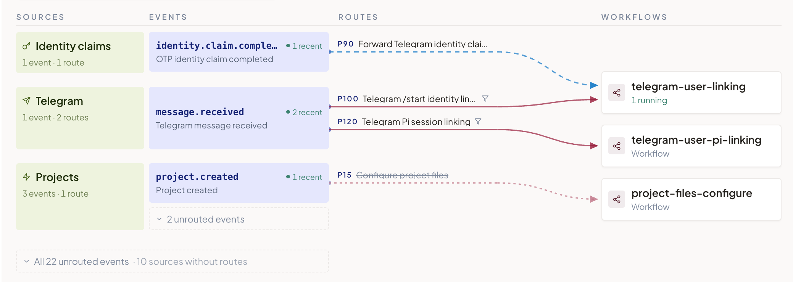
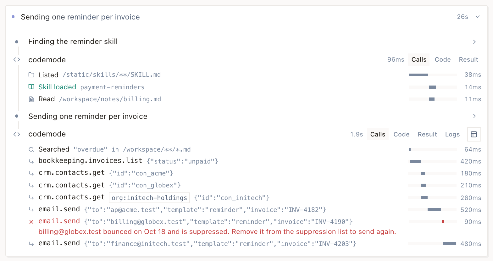
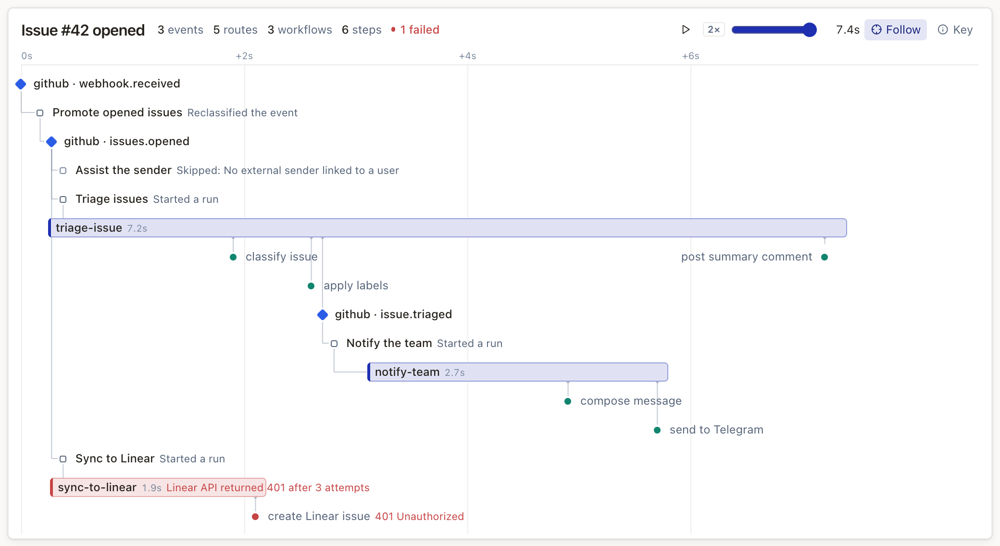

<!-- prettier-ignore -->
<div align="center">


# Backoffice

_An agent workspace where agents write the workflows that run your business._

[](https://github.com/rejot-dev/fragno/actions/workflows/ci.yml)

[](https://www.typescriptlang.org)
[](LICENSE.md)
[](https://discord.gg/jdXZxyGCnC)

[Overview](#overview) • [How it works](#how-it-works) • [Get started](#get-started) •
[Deploy](#deploy) • [Build on Backoffice](#build-on-backoffice) • [Repository](#repository)



<sub>Events from each source reach workflows through routes. Agents create, filter, and turn off
routes; this view shows them read-only.</sub>

</div>

Backoffice is an agent workspace built around programmatic tool calling (`codemode`). You direct
agents to create durable, deterministic workflows. Every component describes its tools in a `.d.ts`
file, which agents read to write code and workflows. The system is event-based: you and your agents
decide which events start which workflows. Each workspace is isolated, and can choose to send data
to other workspaces.

<!-- prettier-ignore -->
> [!TIP]
> To use Backoffice without running it yourself, sign up at
> [backoffice.rejot.dev](https://backoffice.rejot.dev).

## Overview

You describe a process to an agent:

> "When Stripe reports a failed payment, look up the customer and draft a friendly reminder. Ask me
> before it's sent."

The agent writes a workflow file and a route that starts it. From then on, each failed payment runs
the same steps, and the run waits for your approval before the reminder goes out.

A workflow is plain JavaScript. Each `step.do` is durable: a run survives restarts and retries
without repeating finished steps. This excerpt from the Telegram marketplace package links a chat to
a Backoffice account:

```js
export default defineWorkflow({ name: "telegram-user-linking" }, async (event, step) => {
  const chatId = event.payload.chatId;

  const claim = await step.do("create telegram identity claim", async () => {
    return await otp.createIdentityClaim({});
  });

  await step.do("send telegram identity claim link", async () => {
    await integrations.execute({
      connectionId: "backoffice#telegram",
      actionId: "messages.send",
      input: { chatId, text: "Open this link to finish linking: " + claim.url /* … */ },
    });
  });

  // The run sleeps until the person opens the link, for at most 15 minutes.
  await step.waitForEvent("identity-claim-completed", {
    type: "identity-claim-completed",
    timeout: "15 minutes",
  });
  // …
});
```

`otp` and `integrations` are providers; [How it works](#how-it-works) explains them.

### Features

- **Workflows** that start from schedules and events, such as webhooks, with durable steps, waits,
  approvals, and a trace of every step.
- **Agents** that chat with you, work in a shared workspace file system, and run code through
  `codemode`. Built on pi-durable.
- **Integrations**: first-party ones for GitHub, Resend, and Telegram, plus MCP servers, HTTP APIs,
  and more through the OOMOL connector.
- **Generative UI and pages** that agents build and that update as events arrive. Their data syncs
  to the browser, so pages load local-first.
- **Computers**: sandboxed machines with a shell for agents, and an embedded terminal for you.
- **A marketplace** to install and publish automation packages.
- **Organizations** with projects, roles, invitations, and client management for agencies. Each
  workspace can keep its data in the EU or the US.

## How it works

Agents don't call one tool per turn. They write a program against typed providers, and Backoffice
runs it in a sandbox (`codemode`). Saved as a workflow file, the same kind of code runs whenever a
route matches an event. Every event keeps a trace of what it caused:

<table>
  <tr>
    <td width="50%"></td>
    <td width="50%"></td>
  </tr>
  <tr>
    <td><sub>An agent's code runs in <code>codemode</code>. Each provider call shows its duration, and a failed call shows its error.</sub></td>
    <td><sub>One GitHub webhook starts three workflows through routes. The trace shows why one of them failed.</sub></td>
  </tr>
</table>

Backoffice is built from these concepts:

| Concept  | What it is                                                                                                                                                                                                      |
| -------- | --------------------------------------------------------------------------------------------------------------------------------------------------------------------------------------------------------------- |
| Scope    | Where work belongs: a person, an organization, a project, or an installed app. Each scope keeps its own files, connections, routes, and workflow runs.                                                          |
| Provider | A typed API that code calls as a global, such as `integrations`, `models`, or `store`. Agents read its declaration in [`content/static/codemode`](apps/backoffice/content/static/codemode) before writing code. |
| Event    | A record that something happened, with its source, type, payload, and the people or systems involved. Integrations, forms, and Backoffice itself emit events.                                                   |
| Route    | A rule that reacts to an event or a schedule. It starts a workflow, delivers the event to a running workflow, notifies an agent, or forwards the event to another scope.                                        |
| Workflow | A `.workflow.js` file of durable steps. A workflow can sleep, wait for events, and show interfaces, such as a form that asks for your approval.                                                                 |
| Agent    | A conversation that writes and runs code, and creates the routes and workflows above.                                                                                                                           |

## Get started

### Prerequisites

- [Node.js](https://nodejs.org) `^22.22.0` or `>=24.11.0`
- [pnpm](https://pnpm.io) 11
- An [OpenAI API key](https://platform.openai.com/api-keys), so agents can respond

### Run Backoffice locally

1. Clone the repository and install the dependencies:

   ```bash
   git clone https://github.com/rejot-dev/fragno.git backoffice
   cd backoffice
   pnpm install
   ```

2. Create the local configuration, then set `OPENAI_API_KEY` in `apps/backoffice/.dev.vars`:

   ```bash
   cp apps/backoffice/.dev.vars.example apps/backoffice/.dev.vars
   ```

3. Build the dependencies and start the development server. It also starts the sandbox bridge:

   ```bash
   pnpm exec turbo dev --filter=@fragno-apps/backoffice-rr
   ```

4. In a second terminal, create an account. It uses the email `$USER@rejot.dev` and the password
   `wachtwoord`:

   ```bash
   pnpm --filter @fragno-apps/backoffice-rr dev-account:create
   ```

5. Open http://127.0.0.1:5173 and sign in.

<!-- prettier-ignore -->
> [!NOTE]
> The development server prints email to the terminal instead of sending it, including sign-in and
> password-reset links.

## Deploy

Backoffice deploys to Cloudflare Workers: a web Worker, and an object Worker with Durable Objects
and R2 for large files. See [Release](apps/backoffice/README.md#release) in the application's
README.

<!-- prettier-ignore -->
> [!IMPORTANT]
> Backoffice needs a deployed [`cf-sandbox-bridge`](apps/cf-sandbox-bridge) to run code. Deploy it
> before Backoffice.

## Build on Backoffice

- **Apps** sign people in with Backoffice, are installed into organizations, and give agents their
  actions. [Bookkeeping](apps/bookkeeping) is the reference app, and the
  [`backoffice-apps` skill](.agents/skills/backoffice-apps/SKILL.md) explains the integration.
- **The HTTP API** is defined in [`@fragno-dev/backoffice-api`](packages/backoffice-api), with an
  OpenAPI document.
- **The CLI** in [`apps/backoffice-cli`](apps/backoffice-cli) signs in through the device flow, runs
  code in a workspace, and moves files.
- **Marketplace packages** bundle workflows, routes, and agents. See the
  [built-in packages](apps/backoffice/content/marketplace) for examples.

## Repository

| Path                                                               | Contents                                                   |
| ------------------------------------------------------------------ | ---------------------------------------------------------- |
| [`apps/backoffice`](apps/backoffice)                               | The Backoffice application                                 |
| [`apps/cf-sandbox-bridge`](apps/cf-sandbox-bridge)                 | Code execution and sandboxed computers                     |
| [`apps/bookkeeping`](apps/bookkeeping)                             | An accounting app built on Backoffice                      |
| [`apps/backoffice-cli`](apps/backoffice-cli)                       | The command-line client                                    |
| [`packages-private/design-system`](packages-private/design-system) | UI components and their Storybook                          |
| [`packages`](packages)                                             | Fragno, and the Fragno libraries Backoffice's features use |

### Looking for Fragno?

Fragno, the framework for building full-stack libraries, lives in this repository. See its
[README](packages/fragno/README.md) and the documentation at [fragno.dev](https://fragno.dev/docs).
