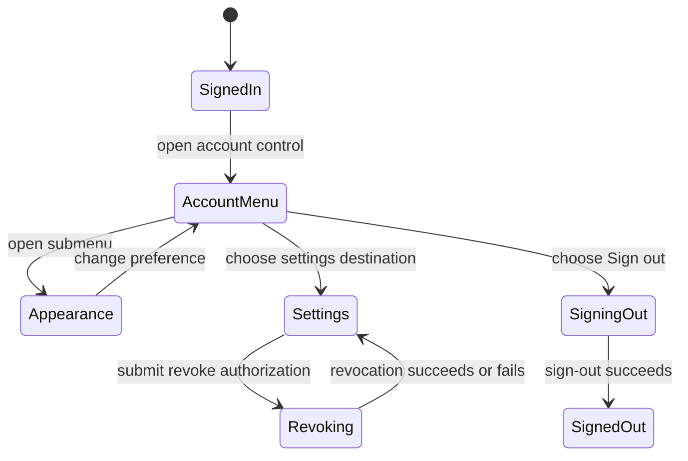

# Account and settings

## Summary

The account menu provides identity and organization shortcuts, appearance preferences, settings,
authorized-application management, admin-only Internals, and sign-out. Settings shows
server-resolved base permissions for the user's system (admin only), personal, and active
organization scopes. Authorized applications lists personal OAuth consents and allows the user to
revoke a client. These are account-level controls; an organization app installation is not the same
thing as a personal OAuth authorization. Shared authentication and role boundaries are described in
[Identity and access](../foundations/identity-and-access.md), and scope presentation in
[Navigation and scope](../foundations/navigation-and-scope.md).

## The simple case

The signed-in user opens the account control in the application header. The menu shows a display
name derived from the email handle, the email address, shortcuts for the active organization,
workspace management links, Settings, Authorized applications, optional Internals for global admins,
an Appearance submenu, and Sign out.

Settings opens My permissions. It presents the account's authentication role and base grants grouped
by scope and permission namespace. Authorized applications shows approved OAuth clients with client
ID, scopes, additional userinfo claims, resources, and last-approved time. The user can revoke one
client at a time. Appearance allows Light, Dark, or System theme and a Reduced motion choice.

## The interaction, event by event

### Arrive

While authentication is loading, the account control shows a checking-session placeholder. If no
user is present, it offers Sign in. For a signed-in user, initials and display name are computed
from the email handle. If an active organization exists, the menu includes Overview, Members,
Invites, and Billing links. All users see Manage organizations, Settings, and Authorized
applications; only global admin users see Internals.

The Appearance preference hook is mounted even when the account menu is not open, so it can apply
stored preferences to the document. Initial theme is the saved choice if valid, otherwise System.
Reduced motion uses the saved choice if valid, otherwise the operating system preference.

My permissions resolves grants on the server for the user's personal scope and active organization;
global admin also gets System scope. A project scope is not listed as a separate row. The display
says these are base role grants and warns that individual actions can still be denied by delegation,
resource policy, object availability, or cross-scope rules. Authorized applications requires a
Backoffice browser session and loads a cursor page with no-store caching.

### Leave untouched

Opening and closing the account menu does not change account data. Navigating to Settings or
Authorized applications is read-only until a revoke is submitted. Changing theme or reduced motion
is itself an immediate local preference update; it does not require a Save button.

### Begin editing

Selecting a theme immediately updates the document's dark class and color scheme and stores `theme`
in local storage. System follows `prefers-color-scheme` and reacts to changes. Reduced motion writes
either `reduce` or `no-preference` to local storage. If no saved motion choice exists, Backoffice
follows `prefers-reduced-motion` and updates when the system preference changes. Storage errors are
tolerated; the current page preference still applies but may not persist.

On Authorized applications, each consent row's Revoke access button submits that client's ID. While
a revoke request is pending, all revoke buttons are disabled; the active row says “Revoking…”. A
successful action redirects back to the list. Failure returns an alert message.

### While editing

Appearance choices remain visible in their submenu while selected so the user can see the immediate
change. There is no confirmation dialog. Theme and motion choices are per browser storage, not
server account settings.

A permission list is descriptive, not an editor. It may show “no access” for a scope and shows the
resolved grants sorted by namespace. The page explicitly warns that listed base grants may not cover
a resource-specific policy. Authorized-applications pagination uses the returned cursor and a Next
page link. Revocation is destructive to the consent and its client's stored refresh/access tokens
and cancels pending device approvals. Existing self-contained tokens may remain usable elsewhere
until expiration; Backoffice execution tokens expire within 15 minutes.

### Submit

Sign out calls the auth client. On success the browser analytics identity is reset and the window is
replaced with `/backoffice/login`. While signing out, the menu label changes to “Signing out…” and
the action is disabled. If sign-out fails, an error note is displayed and the user remains in the
current app; no retry is automatically issued.

Revoking a consent removes that application's authorization and returns to the refreshed
authorized-applications list. The page reports failures with an alert. It does not promise immediate
invalidation of previously issued self-contained access tokens at other systems; that depends on
their expiry/use.

## Modifiers

| Variant                                             | At arrival                                                                                                  | During editing                                                                                       |
| --------------------------------------------------- | ----------------------------------------------------------------------------------------------------------- | ---------------------------------------------------------------------------------------------------- |
| Scope kind: personal, organization, project, system | Account menu is global; organization links use the active org, permissions are grouped by applicable scope. | Navigating to organization shortcuts changes route; the menu does not change authority.              |
| User authority                                      | Global admin sees System permissions and Internals; other users do not.                                     | Revocation acts on the signed-in user's own OAuth consent; server session requirements still apply.  |
| Record/workflow state                               | Sign-in status and available consents determine which controls are shown.                                   | Pending sign-out/revocation disables relevant actions; deleted/revoked consent disappears on reload. |
| Browser/network state                               | Stored appearance and OS preferences determine theme/motion defaults.                                       | Storage failure prevents persistence; auth/network failures can block sign-out or revocation.        |

Theme choice is one of Light, Dark, System. Reduced motion follows the operating-system preference
until the user makes an explicit stored choice.

## Cancel and interrupt

| Event                         | Before editing                                                                       | During operation                                                                                        |
| ----------------------------- | ------------------------------------------------------------------------------------ | ------------------------------------------------------------------------------------------------------- |
| Explicit cancel               | Close account menu/settings without mutation.                                        | No undo for a completed revoke/sign-out; navigating away does not restore a revoked consent.            |
| Navigate or switch            | Choose another menu link; no data is changed by menu opening.                        | Route change can stop observing a revoke; sign-out success redirects regardless of old route.           |
| Competing completion          | No pending operation.                                                                | Revoke buttons are disabled while one revoke is pending; sign-out button is disabled while signing out. |
| Request failure               | Permission/consent load errors use route error handling.                             | Revoke displays an alert; sign-out displays an error note and does not automatically retry.             |
| Page termination              | Local appearance changes apply immediately; storage write may already have occurred. | Closing during revoke/sign-out can leave response unseen; revisit or sign in to confirm state.          |
| Target change                 | Consent may be revoked from another session or the user's role can change.           | Server may reject a stale revoke; permission list re-resolves on navigation/reload.                     |
| Browser/input change          | OS theme/motion preference can change while System/follow mode is active.            | The UI updates theme/motion in response; browser storage denial is tolerated.                           |
| Feature-specific state change | No user or a pending auth check changes which menu variant appears.                  | Auth session expiry can force navigation to login and block protected settings actions.                 |

After a successful sign-out, the shell is replaced by the login route. After a failed sign-out, the
menu displays an error. A revoked authorization is not restored by returning to the page.

## Interactions with other systems

**Permissions.** Settings displays server-resolved base grants, not a guarantee that every specific
operation will succeed. Authorized applications is constrained to the current user's browser
session.

**Persistence/history.** Theme and reduced-motion settings persist in local storage; authorization
consents are server-side. Settings pages are routes and cursor pagination is URL state.

**Parent scope.** Organization shortcuts target the active organization; permissions include
personal and active organization, with System only for global admins.

**Readonly/restricted state.** Permission grants are read-only. The user can revoke only their own
listed consents. Internals is hidden for non-admins.

**Offline.** Appearance applies locally and can work without network after load; permission/consent
fetch, revoke, and sign-out require successful auth requests.

**Collaboration/multiple tabs.** Theme local storage is browser-profile shared, but immediate
cross-tab updates are not guaranteed. Consent changes in another tab appear after
reload/revalidation.

**Notifications.** No notification is emitted for changing appearance. Revoke and sign-out failures
are shown inline; success is represented by the resulting route/list state.

**Preferences and URL state.** Theme and motion are local-storage preferences. OAuth consent
pagination uses a cursor query parameter. Organization links and current scope use route paths.

**External integrations/side effects.** OAuth consent revocation removes the client's stored tokens
and pending device approvals; already-issued self-contained tokens can remain valid until
expiration. Sign-out resets analytics identity.

**Accessibility and analytics.** Account trigger includes an accessible label, authorized-app revoke
buttons identify the client, and errors use alert semantics. Keyboard submenu and focus restoration
need verification.

## Edge cases

- Menu display name is derived from email handle, not a separately editable profile name.
- The appearance hook applies preferences even while signed out or the menu is closed.
- An invalid theme or motion value in storage is ignored in favor of system defaults.
- Browser storage failure is intentionally tolerated; preference may not survive reload.
- Project-specific permissions are not shown as a separate Settings row; the page notes
  project-specific access is enforced when the action executes.
- Authorized applications are personal OAuth grants, not organization app installations or
  permission grants.
- Revocation may not invalidate an already-issued self-contained token at a separate consumer
  immediately.
- Sign-out failure is swallowed by the mutation chain but rendered from the auth client's error
  state; no automatic retry is made.

## Open questions and verification

- Verify theme and reduced-motion menu interaction, persistence across reload, OS preference
  changes, and storage-denied fallback.
- Verify list pagination and consent revocation with a disposable OAuth client; do not revoke active
  production credentials.
- Browser reconnaissance did not open the account menu, change appearance, revoke a consent, or sign
  out.
- Confirm keyboard interaction and focus restoration for nested account/appearance menus.

Verified against /Users/wilco/dev/fragno commit `7dd3c31b5`.
