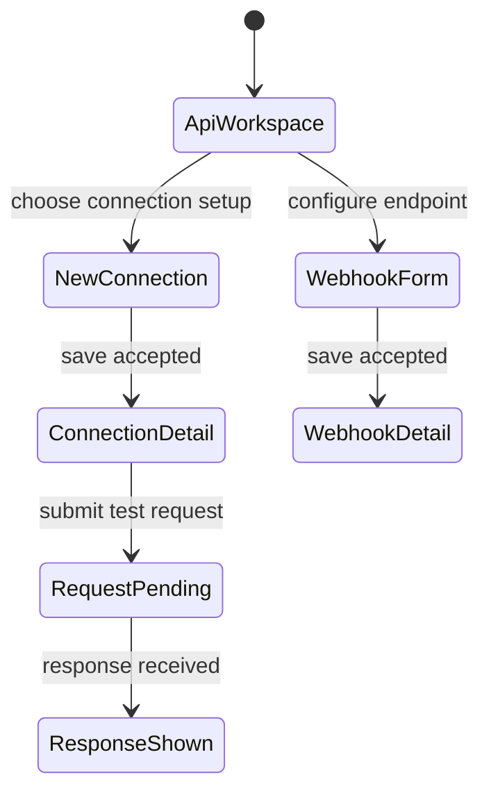

# API connections and webhooks

## Summary

The Automations → API area lets a user register outbound HTTP API connections, store authentication
credentials, authorize an OAuth provider, test requests, and configure inbound webhook endpoints.
Scripts use stable connection slugs and relative paths, so credentials can stay on the server
instead of being embedded in automation code. Webhook configuration is a separate endpoint setup
with status, verification, delivery identity, and authentication controls.

## The simple case

The user opens API in a supported automation scope. The page lists configured API connections and
webhook endpoints and provides a form to create either. For an API connection, the user supplies a
slug and base URL, chooses no auth, bearer, basic, OAuth, or client credentials, and saves. They can
select a connection to inspect its status and run a test request using an HTTP method, relative
path, query, headers, body mode, and timeout. A response panel shows status and body, or a
structured error.

For webhooks, the user creates/configures an endpoint with a slug/ID, delivery status,
authentication, verification and identity settings, then saves. The resulting endpoint reserves its
URL even when in Draft; Draft rejects deliveries. Public endpoint URL and secret handling depend on
the selected verification/delivery settings.

## The interaction, event by event

### Arrive

The API workspace is scoped. Its loader reads API connections, current auth status and webhook
endpoint data. When the connection list is empty, the setup form is available. A selected connection
is represented in route/query state. It shows display name or slug, base URL, auth mode, status,
update time, script ID, auth expiry when supplied, and any auth error.

Connection setup offers five auth modes. Bearer requires a token; Basic requires username/password;
OAuth requires authorization/token endpoints and client ID, allows an optional client secret for
public PKCE clients, scopes, and an auth-method choice; client credentials requires secret and can
include audience; no-auth has no credential fields. The saved connection can then be managed
separately from the API request tester.

### Leave untouched

Viewing a connection or webhook does not call the remote API. Opening the Edit controls does not
clear stored auth. The test request is not sent until Send test request. The API configuration area
does not execute scripts just because a connection is saved.

### Begin editing

A new connection form submits `add-connection`. If OAuth is selected, connection creation is
followed by an OAuth-start request; if that second step fails, the user sees that the connection was
saved but OAuth could not start. A successful OAuth start returns an authorization URL; the user
opens the provider flow separately, then returns through the Backoffice completion route. The
callback can fail after the provider redirected successfully.

For an existing connection, Edit reveals credential controls. The user can clear stored
authentication, restart OAuth, or replace a bearer token. Credentials are masked and stored
server-side. The request tester supports GET, POST, PUT, PATCH, DELETE; path must be relative to the
base URL. Query and headers are JSON objects. Body mode can be Empty, JSON, or Text. JSON mode
requires a parseable JSON body. An optional timeout must be positive and is capped in the input at
120,000 ms; blank uses the runtime default.

Webhook form fields depend on selected verification/authentication modes. The page supports endpoint
status and delivery identity; the exact format of signature validation is selected by the form and
should be checked in the corresponding code/tests before reproducing a specific provider recipe.

### While editing

Connection save shows a pending label. The user can see auth state (authenticated/needs auth and
optional expiry) without seeing stored secrets. Clear removes stored credentials but leaves the API
connection record; Delete removes the connection. Test request keeps the request result associated
with the selected connection, showing response status, status text, and parsed JSON/text/empty body.
If the API itself returns an error, its code/message appears in the result.

Webhook save uses its own action and redirects to the Webhooks tab and selected endpoint after
success. Status update, delete, and other endpoint operations are separate intents. Errors return
inline action messages. A public callback page can display “Authentication complete” or explain why
token exchange failed, including a likely PKCE client-authentication fix.

### Submit

A successful API request test is an actual outbound request through the configured connection and
may have external side effects. The response panel says “API request completed” only for a
successful response; a non-success API result shows the returned error. Test requests are not dry
runs.

Saving a connection stores its base URL and auth configuration. Starting OAuth produces an
authorization URL; final credential persistence occurs only after successful callback exchange.
Clear auth deletes credentials but not the connection. Delete connection removes the connection.
Saving a webhook endpoint persists its config; Draft status reserves the URL but rejects deliveries,
while Enabled status accepts delivery according to its verification configuration.

## Modifiers

| Variant                                             | At arrival                                                                                               | During editing                                                                                                              |
| --------------------------------------------------- | -------------------------------------------------------------------------------------------------------- | --------------------------------------------------------------------------------------------------------------------------- |
| Scope kind: personal, organization, project, system | Selects API connection/webhook data and supported APIs.                                                  | Switching scope changes configuration and authority boundary.                                                               |
| User authority                                      | Determines read/manage/execute rights in the scope.                                                      | Server rechecks connection/webhook/request permissions at submit.                                                           |
| Record/workflow state                               | Auth mode, connection status, token expiry and webhook Draft/Enabled state determine available controls. | Saving auth, OAuth exchange, and remote request response change the displayed state.                                        |
| Browser/network state                               | Loader and provider availability determine whether records and auth state load.                          | Provider/network failure can occur after connection save or request execution; result may be uncertain if response is lost. |

Auth mode determines which credential fields are present; it is chosen before saving the connection.

## Cancel and interrupt

| Event                         | Before editing                                              | During editing                                                                                                 |
| ----------------------------- | ----------------------------------------------------------- | -------------------------------------------------------------------------------------------------------------- |
| Explicit cancel               | Leave form or close Edit; stored config is unchanged.       | No rollback for an outbound request already sent or webhook delivery already accepted.                         |
| Navigate or switch            | Browsing the workspace does not execute an API request.     | Leaving during OAuth or test request ends local observation; remote work may continue.                         |
| Competing completion          | No request is pending.                                      | Pending save/test controls may disable submission; webhook actions can be separate.                            |
| Request failure               | Loader failure uses route error handling.                   | Action displays an error; for external request/OAuth timeout, check connection/provider state before retrying. |
| Page termination              | Unsaved form fields are not established as persisted.       | Closing after request send can hide response while target service already processed the request.               |
| Target change                 | Connection may be removed or credentials revoked elsewhere. | Stale connection or endpoint returns service/authorization failure.                                            |
| Browser/input change          | Password manager/autofill can fill secrets; not verified.   | Network loss and browser redirect behavior can interrupt OAuth or API response.                                |
| Feature-specific state change | OAuth credentials can be expired or missing on arrival.     | Provider can reject credentials; webhook status can change while the editor is open.                           |

After an interrupted test request, do not assume the remote side effect was undone. Reconcile with
the target API before retrying non-idempotent POST/PATCH operations.

## Interactions with other systems

**Permissions.** Scoped API route checks govern reading connections, managing credentials/endpoints,
and executing requests.

**Persistence/history.** Connections, stored auth, and webhook endpoints persist independently. Test
request result is page state; no complete audit history is described here.

**Parent scope.** Connections and endpoints belong to the selected automation scope.

**Readonly/restricted state.** A user can inspect connection details without permission to change
credentials or execute requests.

**Offline.** Save, OAuth, and test requests require network. There is no offline queue.

**Collaboration/multiple tabs.** Another operator may update credentials or remove a connection.
Refresh the scoped view to reconcile.

**Notifications.** Action messages and the OAuth completion page show results inline; no
notification is implied.

**Preferences and URL state.** Selected API tab/connection/webhook and OAuth completion state are
route/query state. Local request form data is not established as persistent.

**External integrations/side effects.** Test requests call the configured remote host; OAuth
redirects to a provider; enabled webhook endpoints receive external deliveries.

**Accessibility and analytics.** Forms use labeled inputs and errors are presented inline. Verify
keyboard mode-switching and alert announcement. No specific analytics event is established for test
requests.

## Edge cases

- OAuth connection creation can persist before OAuth authorization startup fails.
- Public PKCE clients may need token endpoint auth method `none` and no client secret; callback
  success at the provider is not final token exchange success.
- Clearing stored auth is distinct from deleting the connection.
- Empty/malformed JSON query/header/body values can reject the test request locally.
- A test request can change remote state; this form has no dry-run mode.
- Draft webhooks reserve a URL but reject deliveries.
- API request timeout input is capped at 120,000 ms in the interface; the runtime default applies
  when blank.

## Open questions and verification

- Review the remaining webhook editor and API scenario tests before asserting exact auth-signature
  fields, retry, response-body limits, or callback expiry rules.
- Browser pass did not create a connection, authorize OAuth, send a test request, or mutate a
  webhook. Use disposable endpoints and test OAuth clients.
- Confirm exact handling of a test request whose server-side effect succeeds but whose response is
  lost.

Verified against /Users/wilco/dev/fragno commit `7dd3c31b5`.
