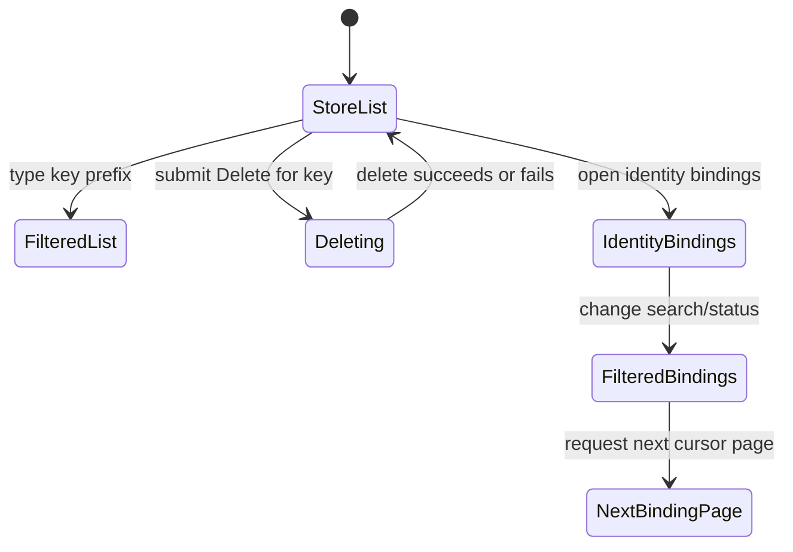

# Automation store and identity bindings

## Summary

The Store area lets an authorized user inspect scoped automation key/value entries, filter them by
key prefix, delete an entry, and switch to a read-only view of external identity bindings. Store
entries can be written by automation operations; this screen does not offer a value editor or create
form. Identity bindings show which external identities are linked to Backoffice users and whether
each binding is active or revoked.

## The simple case

The user opens Automations → Store in a scope. The page loads the local-first automation collection
and lists entries in key order with value, description, category, created time, and updated time.
Typing a prefix narrows the visible entries. The user can delete an entry from its row; the page
reports “Store entry deleted.” or an error. The Identity bindings subpage provides search, status
filter, and cursor-style next/previous paging for bindings in the same scope.

## The interaction, event by event

### Arrive

Store reads the scoped key/value collection through a live query. While the collection is loading
and has no rows, it displays “Loading the local automation store…”; if JavaScript is unavailable, a
message says JavaScript is required. The page's Key prefix input initializes from the `prefix` query
parameter, but changes are local state rather than immediate URL navigation.

Each store row includes the full key and value, optional description and category, and formatted
creation/update times. Empty results render an empty table body rather than a separate empty-state
message. Identity bindings require `identity.read` authority before their loader returns the page.
They show external source/type/ID, user ID, active/revoked status, verified claim ID, and
bound/revoked timestamps.

### Leave untouched

Inspecting a value or binding does not modify it. Changing the store prefix filters the live query;
it does not write the query string back to the URL. Identity search/status changes filter
client-side loaded collection data and reset its current-page cursor stack.

### Begin editing

The Store page offers Delete, not edit or create. Submitting Delete includes the entry's key and a
`delete-store-entry` intent. The action rejects an unknown intent or blank key with an error
message, then checks scope authority and attempts deletion. The button for the submitted key
displays “Deleting…” and is disabled while that key is pending.

Identity bindings search across binding ID, source, external type/ID, user ID, and verified claim
ID, case-insensitively. Status options are All, Active, and Revoked. The list is ordered by source,
external type, external ID, and binding ID; it fetches 26 rows to determine whether another page
exists, displays up to 25, and carries a keyset cursor in local component state. This is cursor
pagination, not an offset page number.

### While editing

The store query reacts to the prefix and synchronized collection updates. The page shows action
feedback at the top; successful deletion produces “Store entry deleted.” and failed deletion shows
an error. Deleting an entry removes it from the live query when synchronization reflects the
mutation.

Identity binding collection errors show a synchronization warning; with no rows, the panel
distinguishes loading, unavailable, no matches, no entries, and no rows remaining after cursor
filtering. While an error exists, visible rows can remain rendered with a warning. There is no
binding mutation control on this page.

### Submit

A successful delete removes the scoped key/value entry. There is no undo in the UI, and the value is
not retained as an editable draft. A failed deletion leaves the entry visible if the collection
still contains it. Identity filter changes and paging are read-only; navigating to another page does
not change any binding.

## Modifiers

| Variant                                             | At arrival                                                                                  | During editing                                                                                       |
| --------------------------------------------------- | ------------------------------------------------------------------------------------------- | ---------------------------------------------------------------------------------------------------- |
| Scope kind: personal, organization, project, system | Selects the store and identity-binding collection.                                          | Switching scope navigates to a different data/authority boundary.                                    |
| User authority                                      | Store delete and identity read require the relevant scoped permissions.                     | Delete is checked at submission; identity page may return 403 if access is missing.                  |
| Record/workflow state                               | Current keys, live collection readiness, binding status, and cursor determine visible rows. | Synchronization can add/remove rows; filters reset identity paging.                                  |
| Browser/network state                               | Browser database initialization determines whether local store is ready.                    | Storage/network failure can show loading/error states; no offline mutation guarantee is established. |

The key-prefix field and identity search/status are filters, not saved mutations.

## Cancel and interrupt

| Event                         | Before editing                                                       | During operation                                                                                     |
| ----------------------------- | -------------------------------------------------------------------- | ---------------------------------------------------------------------------------------------------- |
| Explicit cancel               | Leave the filter unchanged or navigate away; nothing is written.     | No delete cancellation control is shown; a submitted deletion may already commit.                    |
| Navigate or switch            | Changing tabs leaves the current filter/page.                        | A pending delete may complete even if its result is no longer visible.                               |
| Competing completion          | No operation is pending.                                             | The same entry button is disabled while its delete is submitting; another row may remain actionable. |
| Request failure               | Collection/identity loader failures show loading/error presentation. | Delete returns an error notice; reload to reconcile before retrying.                                 |
| Page termination              | Filter/paging state is not guaranteed to persist.                    | Closing during deletion may hide the response after server acceptance.                               |
| Target change                 | A key/binding can disappear from the live collection.                | Concurrent deletion or authorization change can reject a stale delete.                               |
| Browser/input change          | Search/filter controls are local to the page.                        | Browser storage failure can interrupt local synchronization; it does not make a delete reversible.   |
| Feature-specific state change | Binding may already be revoked or store key absent.                  | Binding state can change remotely; this page is read-only for bindings.                              |

After a failed or uncertain delete, refresh the collection and check whether the key remains. There
is no store-entry restore action in this screen.

## Interactions with other systems

**Permissions.** Store mutation and identity-binding reads use separate scoped permissions. A
visible store row does not guarantee delete authority.

**Persistence/history.** Store values are durable scoped entries, but the page exposes no edit
history or undo. Identity binding timestamps/status reflect persisted records.

**Parent scope.** Both data sets belong to the currently selected automation scope.

**Readonly/restricted state.** Identity bindings are read-only in this screen. Store may be readable
without delete permission.

**Offline.** Local-first data can load or fail to synchronize; delete requires the server-side
operation.

**Collaboration/multiple tabs.** Store entries or identity bindings can change elsewhere; live
collection refresh is the source of visible updates. Conflict behavior is server-authoritative.

**Notifications.** Store delete feedback is inline. No notification is known for read-only
filtering.

**Preferences and URL state.** Store prefix can initialize from `prefix` but subsequent typing stays
local. Identity filters and cursor stack are component state.

**External integrations/side effects.** Deleting a key can change later automation behavior that
reads it. Binding inspection has no external side effect.

**Accessibility and analytics.** Inputs have labels, status messages are visible, and tables use
column headers. Keyboard table navigation and error announcements need manual verification.

## Edge cases

- A prefix of `telegram/` shows only keys beginning with that exact prefix.
- Deleting requires a non-empty trimmed key and an exact supported intent.
- Store loading is distinguished from empty results only while loading and no data is present.
- Identity pagination requests one extra item to detect the next page but displays 25.
- Changing identity search or status resets paging; moving backward pops one cursor boundary.
- Revoked bindings remain visible when the Revoked filter is selected; there is no revoke action
  here.

## Open questions and verification

- The browser pass did not open Store or Identity bindings. Verify prefix behavior, delete feedback,
  authority denial, synchronization failure, filters and cursor navigation.
- Verify whether the `prefix` query parameter is updated elsewhere; the inspected component only
  uses it to initialize local input state.
- `formatTimestamp` is shared with session history and may inherit the server/browser timezone
  mismatch recorded as
  [B-01](../bug-triage.md#b-01-session-history-timestamps-differ-between-server-and-browser).

Verified against /Users/wilco/dev/fragno commit `7dd3c31b5`.
