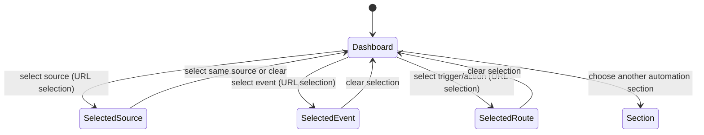

# Automations

## Summary

The Automations workspace lets users inspect and configure event sources, triggers, workflow starts,
workflow routes, API connections, integrations, MCP servers, sandboxes, and stored values within a
selected scope. The Orchestration dashboard presents these relationships as swimlanes; selecting a
source, event, trigger, or action opens a contextual inspector. The broader area is reached from the
shell's Automations link and its nested section navigation. Shared scope and route switching
behavior is described in [Navigation and scope](../foundations/navigation-and-scope.md), and
local-first synchronization states in
[Persistence and asynchronous work](../foundations/persistence-and-async-work.md).

## The simple case

The user opens the scoped automation dashboard. The page shows Sources, When, and Then lanes for
workflow routing, plus the automation section tabs. Existing configured routes and event-source rows
appear as selectable items. Selecting an item opens an inspector alongside the swimlane; selecting
it again or clearing selection closes the inspector. The user can move to Events, Store, API,
Integrations, MCP, or Sandboxes to inspect or manage the corresponding configuration.

The dashboard is built from synchronized automation collections and can display an error notice if
some data cannot be synchronized. Empty and loading states are not equivalent to an empty, fully
synchronized workspace. The exact create/edit operations differ by subsection and are owned by their
respective forms; this document describes the dashboard interaction and the top-level area rather
than claiming every connector's form behaves identically.

## The interaction, event by event

### Arrive

The dashboard's route loader supplies workflow source context and a runtime tool catalog;
client-side collections supply sources, routes, events, and workflow instances. The URL can carry a
source filter, a selection kind and ID, and a workflow script ID. When a selection maps to a current
source/event/route, an inspector is rendered. Invalid or stale selection data may not resolve to an
inspector.

At widths where the inspector is shown beside the dashboard, its width is bounded by a 320-pixel
minimum and an available maximum; its width is stored in local storage when possible. The
dashboard's lane content has a minimum width of 43rem, so narrow layouts can require horizontal
scrolling. Browser verification of exact breakpoint behavior remains open.

### Leave untouched

Viewing the dashboard or changing automation section does not itself create or modify a route.
Selecting and deselecting dashboard items changes URL search parameters and the inspector, not the
underlying automation configuration. The dashboard does not show a global dirty form state for these
selections.

### Begin editing

Clicking a source, event, trigger, or action selects it. The selected kind and ID are reflected in
query parameters. Selecting a workflow source also sets a source filter; selecting the
already-active source toggles the filter and selection off. Selecting the same item of another
supported kind clears its selection. Selection may clear the source filter when the user chooses an
event, trigger, or workflow action, so the inspector's context follows the selected item.

Selecting a route action may also include its workflow script ID in URL state. The inspector
provides contextual detail and links to related areas such as the Events catalog or scoped Files
workspace. The user can resize the inspector with its vertical handle; keyboard resizing and
double-click reset are supported by the handle, with exact steps best verified in the browser.

### While editing

The swimlane data can update as synchronized collections change. A top-level error notice appears
when some dashboard data could not be synchronized, while successfully available data remains
visible. Source highlighting describes which routes are being highlighted; in Events view, available
event sources remain visible even without a source selection.

The inspector width is persisted locally when storage works and clamped to the available
minimum/maximum. If local storage is unavailable, the layout remains usable but the chosen width may
not survive a reload. Search parameters make selected dashboard state linkable and subject to
browser history.

### Submit

Dashboard selection finishes immediately as a route-state change; no server-side mutation is
committed by selecting an item. Clearing selection removes the source filter, selection kind,
selection ID, and workflow script ID from the query string. For actual configuration forms, the
chosen subsection's successful save behavior is authoritative and will generally revalidate or
update its data; those forms are not all described as one submit action here.

## Modifiers

| Variant                                             | At arrival                                                                                         | During editing                                                                           |
| --------------------------------------------------- | -------------------------------------------------------------------------------------------------- | ---------------------------------------------------------------------------------------- |
| Scope kind: personal, organization, project, system | Selects which automation data and configuration are loaded.                                        | Changing scope navigates to the equivalent supported section or its fallback.            |
| User authority                                      | Determines which configuration actions are available and accepted.                                 | A server-side action can reject a mutation even if the dashboard was already open.       |
| Record/workflow state                               | Loading/synchronized data and route enabled/disabled status determine displayed rows and controls. | Collection changes can add, remove, or update rows and the selected inspector.           |
| Browser/network state                               | Local-first database startup and route availability affect initial rendering.                      | Synchronization errors are shown; local inspector width may not persist without storage. |

Selection state is URL-driven. Dashboard route data can change while the user is viewing it; the UI
does not promise a frozen snapshot.

## Cancel and interrupt

| Event                         | Before editing                                                                                          | During operation                                                                                        |
| ----------------------------- | ------------------------------------------------------------------------------------------------------- | ------------------------------------------------------------------------------------------------------- |
| Explicit cancel               | No pending mutation exists; close/clear selection leaves configuration unchanged.                       | Clearing inspector selection removes its URL state; forms in other tabs have their own cancel behavior. |
| Navigate or switch            | Changing sections leaves the dashboard without a dashboard mutation.                                    | Switching scope or section supersedes selected URL state; open form drafts may be feature-specific.     |
| Competing completion          | No pending operation.                                                                                   | Another user or background synchronization can update rows while the inspector is open.                 |
| Request failure               | Loader failure uses route error handling; collection failure may show dashboard synchronization notice. | A configuration mutation can fail according to that form; selection itself does not save.               |
| Page termination              | URL selection remains addressable if copied/bookmarked; local width may persist.                        | Reload restores URL parameters but can reinitialize local-first data and layout state.                  |
| Target change                 | A stale selection may no longer map to a current route/event.                                           | Deletion, disabled status, or authority change can make inspector actions unavailable or fail.          |
| Browser/input change          | Focus does not change the selected item.                                                                | Pointer, keyboard, or storage failures can affect resize/selection; no data mutation is implied.        |
| Feature-specific state change | Source or route may already be disabled.                                                                | Synchronization can update the route's status; being selected does not activate it.                     |

After an interruption, route query parameters describe the selected inspector state;
synchronized/server data determines whether that target still exists. No dashboard-selection action
is an undoable configuration change.

## Interactions with other systems

**Permissions.** The effective scope and user authority govern configuration actions. UI selection
alone does not authorize route mutation.

**Persistence/history.** Dashboard selection is encoded in the URL and participates in navigation
history according to router behavior. Inspector width is stored in local storage. Configuration
forms save separately.

**Parent scope.** Sources, routes, events, and connections are read within personal, organization,
or project scope as supported by that section.

**Readonly/restricted state.** A row may be inspectable while modifying it is not allowed. The
dashboard may show disabled routes without treating them as absent.

**Offline.** Local-first data can show initialization/synchronization states, but a universal
offline configuration queue is not established.

**Collaboration/multiple tabs.** Synchronized collections can refresh the dashboard; conflict
behavior for simultaneous configuration edits is specific to the relevant mutation.

**Notifications.** Sync errors are shown inline in the dashboard. No notification is known to be
sent for selecting an inspector item.

**Preferences and URL state.** Inspector selection and source filter use query parameters; inspector
width uses local storage. Script view/graph detail query parameters are present in the observed
section links and may be retained across section navigation.

**External integrations/side effects.** Automation routes can start durable workflows and invoke
external integrations when triggered; selecting their dashboard card does not trigger them.

**Accessibility and analytics.** Dashboard items are interactive controls and the inspector resize
handle supports keyboard input. Confirm labels/focus behavior manually. Scope selection and
configuration analytics are feature-specific.

## Edge cases

- A source filter can be set while a selection kind/ID is absent or stale; the dashboard resolves
  only selections that match loaded data.
- Selecting an event, trigger, or workflow action clears the source filter; selecting an event
  action retains its source context.
- Clicking the active source toggles the source filter and selection off.
- System scope does not support API, MCP, or Sandboxes through the scope-switch path; it falls back
  to Dashboard.
- Some dashboard data can fail to synchronize while other lanes remain visible.
- Inspector width is stored by browser; private browsing or storage denial can reset it.
- Disabled trigger rows remain inspectable; selection does not enable a trigger.

## Open questions and verification

- The browser pass observed the current dashboard lane labels and one disabled trigger, but did not
  click rows, resize the inspector, or switch scope.
- Verify query parameter changes for each selection kind, clicking an active item twice,
  back/forward restoration, and stale selection after data changes.
- Verify responsive horizontal scrolling and inspector minimum/maximum width at supported viewports.
- The seven section links have distinct behaviors; API, Store, MCP, Sandboxes, integrations, and
  event editing require deeper per-form verification before claiming their complete workflows.

Verified against /Users/wilco/dev/fragno commit `7dd3c31b5`.
