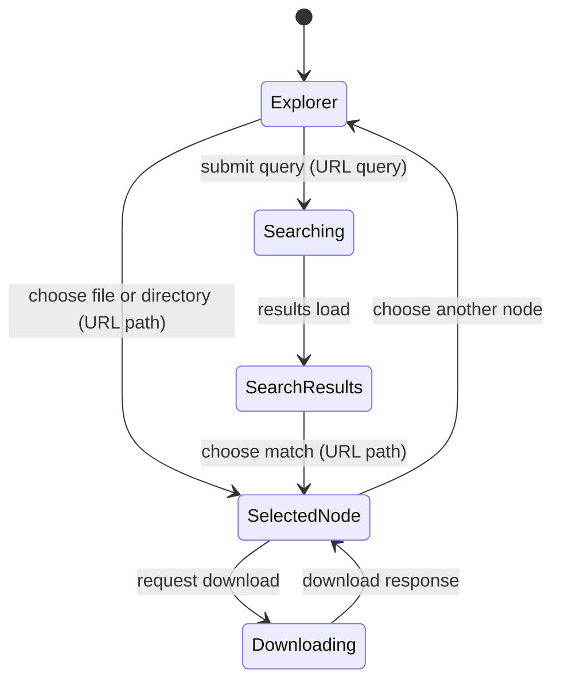

# Files

## Summary

Files provides a scoped explorer for product guidance, automation workspace files, or system-scope
metadata. Users browse a tree, select directories or files, inspect metadata/content, search indexed
text, download supported files, and follow links from workflow-related files. The scope determines
which roots exist: System scope has `/system`; personal, organization, and project scopes have
`/static` and `/workspace`.

## The simple case

The user opens Files in the shell. The explorer loads file-source roots and selects the default root
if one is available. On a typical personal or organization scope, Static contains immutable
product-owned guidance and Workspace contains persistent scope-owned uploads. The tree appears
beside a detail pane. Selecting a file shows its content or a content renderer; selecting a
directory/root shows a summary. The user can search file contents using the search field and open a
match, or download a supported file.

System scope differs: its root is System and is read-only, containing admin-only system automations
and metadata. A file path is addressable in the route, so a direct link can restore a selected path.
Files is scoped; the same path text does not imply the same underlying file across scopes. Scope
resolution is described in [Navigation and scope](../foundations/navigation-and-scope.md); shared
synchronization and persistence distinctions are in
[Persistence and asynchronous work](../foundations/persistence-and-async-work.md).

## The interaction, event by event

### Arrive

The loader resolves and authorizes the scope, loads available file collections, and reads the
requested path and `q` query. If no path was requested, it chooses `/workspace` when available,
otherwise the first available collection root. On personal/organization/project scope, Workspace is
therefore normally the initial selection and Static is another root; on System scope, System is the
root. A missing path outside synchronized roots adds an error and falls back to the default root.

The explorer shows an error message above the tree when collections or synchronization fail. For
upload-backed Workspace files, server-provided sources can render first, then the browser-side
synchronized collection replaces the tree once ready. A selected synchronized path that is not
present in the ready local tree is reported as missing. Some file types have specialized renderers,
while text content can appear in the detail view. The Static and System roots are read-only;
Workspace is marked writable.

### Leave untouched

Browsing/selecting a node changes the URL to that node's scoped file path but does not write the
file. The mobile explorer can hide the tree to give more room to the content pane; toggling this is
view state. Search is a GET form, so submitting a query updates route state rather than editing file
content.

### Begin editing

Files does not provide a general content editor in the explorer. The primary interactions are
selection, search, preview, and download. Selecting a node leads to a canonical path. Text search
trims the query and searches each loaded collection for matching file contents. The search service
requests at most 50 matches per source and includes one line of context before and after each match.
Search results are grouped by root and file; a query with no matches displays “No content matches”.

The search field includes a clear control when a query exists. Clearing returns to a node route and
removes the query. Selecting a match navigates to its file path and leaves the search result view.
On mobile, “Hide file tree”/“Show file tree” toggles the tree region; this does not change the
selected path.

### While editing

Workspace upload files synchronize through the browser's local-first upload database. The explorer
can be in loading, ready, or error state. When synchronization is unavailable, the server snapshot
can still show an error state; a synchronization failure is appended to load errors. Workflow file
routing is also resolved from automation routes and has its own loading/error/ready states, used by
relevant file renderers.

The file tree keeps collapsed-root state through its explorer component; persistence across reload
is not established. Preview metadata can include provider, filename, status, visibility, creation
time, and preview URL. The detail pane may show file size, type, updated time, child counts, and
read-only/persistence labels where supplied. The exact fields differ by source and node kind.

### Submit

Selecting a node completes as navigation. A search submission loads grouped matches and may also
include per-source search errors. A download follows the scoped download URL and returns the file
response; the route does not make a content edit. If a path is unknown, the page reports the missing
path and falls back to the default selection. If the scope itself cannot be opened, the Files error
boundary presents “File workspace unavailable” with a status and message.

## Modifiers

| Variant                                             | At arrival                                                                                                | During editing                                                                                     |
| --------------------------------------------------- | --------------------------------------------------------------------------------------------------------- | -------------------------------------------------------------------------------------------------- |
| Scope kind: personal, organization, project, system | Determines roots and their authority; System has `/system`, other scopes have `/static` and `/workspace`. | Switching scope navigates to a different file collection boundary.                                 |
| User authority                                      | System files are admin-only; workspace access is checked for the selected scope.                          | Read-only roots cannot be changed through this explorer; server rejects unauthorized file actions. |
| Record/workflow state                               | Selected path, source availability, and synchronization state determine the displayed node.               | Tree updates may add/remove files; missing selected paths produce an error/fallback.               |
| Browser/network state                               | Route load and browser synchronization determine whether sources/content are ready.                       | Search/download/sync can fail; there is no established offline editing queue.                      |

The same path name in another scope may refer to different content or no file at all.

## Cancel and interrupt

| Event                         | Before editing                                                                                                     | During operation                                                                                     |
| ----------------------------- | ------------------------------------------------------------------------------------------------------------------ | ---------------------------------------------------------------------------------------------------- |
| Explicit cancel               | No pending write exists. Clear search or select another path.                                                      | A download can be canceled by the browser; no file mutation is underway.                             |
| Navigate or switch            | Leaving the explorer changes route/scope; no file write is implied.                                                | A new route replaces current search/selection; synchronization may continue as page state permits.   |
| Competing completion          | No pending mutation.                                                                                               | A search, download, or local synchronization can overlap only according to browser/router behavior.  |
| Request failure               | Missing or inaccessible scope produces the file workspace error boundary.                                          | Search errors are reported with collection errors; download failure uses route/browser handling.     |
| Page termination              | URL path/query can be restored on reload; mobile collapse state may reset.                                         | Reload/close ends current search/download observation; already persisted upload remains server-side. |
| Target change                 | A stale path can fall back to default with an error.                                                               | A synchronized file removed elsewhere can disappear and trigger a path-missing message.              |
| Browser/input change          | Tree selection and mobile collapse can be controlled by pointer/keyboard; exact focus sequence needs verification. | Offline/storage failure can prevent local synchronization; selection does not commit a write.        |
| Feature-specific state change | Workflow routes may still be loading when file view arrives.                                                       | Workflow-linked content can show route loading or error independently of file availability.          |

After an interruption, the URL identifies the selected path or query; the current authorized
collection and synchronization state determine whether it still exists. The explorer itself has no
unsaved file edit to recover.

## Interactions with other systems

**Permissions.** Scope resolution and file collection authorization gate source access. System root
is admin-only; root labels do not override server checks.

**Persistence/history.** File path and search query are route state. Workspace files are marked
persistent and are backed by scoped upload storage; Static/System are product-owned read-only
content. Tree collapse persistence is not established.

**Parent scope.** Workspace files are owned by the selected personal, organization, or project
scope. Static content is immutable product-owned guidance. System files belong to system scope.

**Readonly/restricted state.** Static and System roots are read-only. Workspace is the writable
collection, though this explorer is primarily a browser/preview; upload management is also available
through Connections → Upload.

**Offline.** Workspace file synchronization uses a local-first browser database. Loading and
synchronization errors are visible; no guarantee of offline upload or write queue is made here.

**Collaboration/multiple tabs.** Synchronization may update file listings from remote changes.
Conflict resolution and cross-tab immediacy are not established.

**Notifications.** Load/synchronization failures display inline; no notification is known for
selecting, searching, or downloading.

**Preferences and URL state.** The selected path and `q` search query are encoded in the URL.
Root-collapse and mobile tree visibility are view state; the former's persistence is unknown.

**External integrations/side effects.** Workspace entries can come from the Upload provider.
Download retrieves stored content; no external action is implied by preview.

**Accessibility and analytics.** Search has an accessible searchbox label, tree has an accessible
label, and mobile tree toggle exposes `aria-expanded`. Verify keyboard traversal and content
renderer semantics manually.

## Edge cases

- No available file sources shows “This workspace has no files yet.”
- Workspace is preferred as the initial root whenever it exists; Static is another root, not the
  default.
- A selected folder path has a trailing slash/canonical directory identity; files do not.
- A missing unsynchronized path appends an error and falls back to a default path; a missing
  synchronized path may be detected only after the local collection is ready.
- Search caps results at 50 matches per collection and groups results by source and path.
- If the upload synchronization source is unavailable, the server-side tree is retained with a
  synchronization error rather than silently treated as current.
- System scope contains a different root set from personal/organization/project scope.

## Open questions and verification

- Browser verification opened the organization Files root and a Workspace text file on October
  11, 2026. The tree showed Workspace and Static; Workspace was selected by default. The text detail
  showed a plain-text preview and Download link. Search, mobile tree behavior, and sync failures
  remain unchecked.
- Confirm exact supported renderers and download eligibility for each file type before treating all
  files as previewable/downloadable.
- The `files` view does not itself edit Workspace files; upload and management flows under
  Connections → Upload are separate and need deeper documentation if those are in the selected
  product scope.
- Verify that selected path errors and local-first tree updates match the described fallback
  behavior.

Verified against /Users/wilco/dev/fragno commit `7dd3c31b5`.
