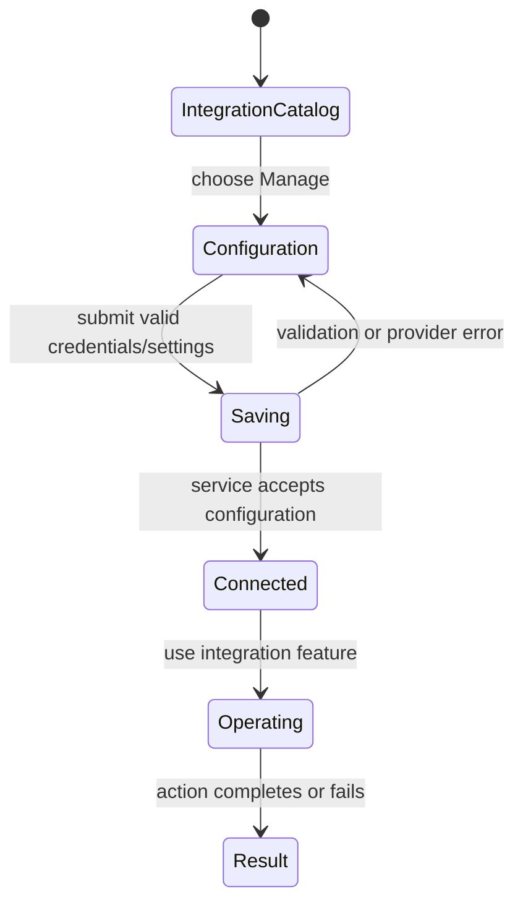

# Integrations

## Summary

Integrations connect a Backoffice scope to external services and expose their configuration and
operational pages. The Automations → Integrations overview shows Telegram, Resend, Reson8, and
GitHub with scope availability and setup/connected/error status. API connections, MCP servers,
Forms, and Upload are neighboring automation capabilities with dedicated screens. The
service-specific pages let users configure credentials and use the resulting connection—for example
sending email, inspecting Telegram messages, linking GitHub repositories, or transcribing audio.

## The simple case

The user opens a supported scope's Integrations page. Each integration card explains what it is and
offers Manage when that scope supports it. The overview reports Checking while capability events
load, Connected when a configured event exists, Setup required when none exists, Status unavailable
on query failure, or Unavailable for a scope the service does not support.

The scope matrix is intentionally uneven: Telegram supports System, organization, project, and
personal scopes; Resend supports System and organization; Reson8 and GitHub are organization-only.
Forms appears as a System integration. GitHub's organization route opens configuration until linked
repositories are available, then directs the user to repositories. A provider may redirect to its
own authorization page; that third-party surface is outside this product description. Shared scope,
authority, and persistence rules are described in
[Navigation and scope](../foundations/navigation-and-scope.md),
[Identity and access](../foundations/identity-and-access.md), and
[Persistence and asynchronous work](../foundations/persistence-and-async-work.md).

## The interaction, event by event

### Arrive

The Integrations catalog shows only the four scoped configurable integrations. Scope support is
checked separately from configuration status. Unsupported cards display Unavailable and have no
management link. When a supported configurable integration's capability event appears, its status is
Connected; absence means Setup required. If the collection is loading, the card says Checking, and
if it errors it says Status unavailable.

For Telegram configuration, the bot token is required and treated as a password. The bot username is
optional and strips a leading `@`; API base URL is optional but must use HTTP or HTTPS. Existing bot
token is never displayed after save. If existing credentials cannot be read, configuration is
blocked to avoid accidental replacement.

Resend configuration governs defaults; its outgoing email page uses those defaults and requires
recipients, subject, and either text or HTML. Optional from/reply-to/cc/bcc and scheduled delay
fields are supported. GitHub setup can connect an account and choose repositories. Reson8 provides
custom-model management, prerecorded transcription, and browser microphone transcription. These
subfeatures have their own input-specific states.

### Leave untouched

Opening the catalog, reading connection status, or viewing a configuration page does not by itself
send an external message or change settings. An OAuth start is a distinct user action. Viewing
Resend inbox/outbox or Telegram message threads is not a send action.

### Begin editing

A configuration form collects provider-specific credentials/settings. Telegram validates a nonempty
trimmed bot token and optional absolute HTTP(S) API URL before submission. The server stores the
configuration and creates a webhook secret; if webhook registration returns failure, the page
reports an error rather than claiming the connection is ready. On success the token input is cleared
and the page displays a saved/configured message.

Resend's Send email form parses recipient lists by comma or newline, trims the subject and content,
and rejects missing recipients, missing subject, or both body formats empty. A positive scheduled
delay can be expressed in minutes, hours, or days. On submit, Backoffice queues the email and resets
the form only after success. “Queued” does not mean delivered.

Reson8 prerecorded transcription requires an audio file and can select an optional custom model and
timestamp inclusion. A successful file transcription replaces the conversation panel. Live
microphone capture is browser-only; it streams audio to Reson8 and appends final transcript
segments. Starting live capture clears a file-only transcript. GitHub repository actions and
Telegram messaging similarly require their corresponding connection and action permissions.

### While editing

Saving Telegram settings disables the submit button while the route is submitting. Existing
credentials remain hidden. A configuration read error blocks the form. Service errors are shown as
messages. GitHub OAuth may involve a provider redirect and callback; a successful provider redirect
can still be followed by a failed token exchange, for which Backoffice shows the error and a likely
configuration remedy.

Resend's Send email button is disabled while its fetcher is busy. Failure keeps the form data and
shows an error; success resets it and adds the queued message to the outbox view. Reson8 file
transcription disables the submit button while running. Its realtime path has interim text, final
segments, and a recording download; page hydration is required for microphone controls. The
conversation panel is local interaction state: uploading a new prerecorded file replaces its
transcript; live segments append until the user clears the conversation or uploads another file.

### Submit

A successfully saved Telegram configuration stores credentials server-side and may register a
webhook; the user receives a success message. The secret is not echoed. GitHub OAuth success stores
credentials; failure returns to Backoffice with provider/code details and a route back to API or
GitHub configuration. The provider callback itself does not guarantee the final credential exchange
succeeded.

A successful Resend action returns “Email queued for delivery” and a record; sending is an external
side effect and cannot be treated as reversible. A failed send returns an error and does not reset
the form. Reson8 prerecorded success adds the transcript entry and clears the selected filename.
Live recording adds final transcript entries; the user can download the recorded audio when
available or clear the local conversation panel.

## Modifiers

| Variant                                             | At arrival                                                                                                             | During editing                                                                                                        |
| --------------------------------------------------- | ---------------------------------------------------------------------------------------------------------------------- | --------------------------------------------------------------------------------------------------------------------- |
| Scope kind: personal, organization, project, system | Determines whether each service is available and which connection record is used.                                      | Switching scope navigates to a different integration configuration and authority boundary.                            |
| User authority                                      | Determines whether the user can read/manage/execute the connection.                                                    | Server checks apply again on save/send/execute; an already-open form does not grant access.                           |
| Record/workflow state                               | Configured credentials, webhook state, linked repositories, and provider state determine status and available actions. | Provider acceptance, connection error, or queued/completed work changes the result.                                   |
| Browser/network state                               | Catalog synchronization, OAuth callback availability, and browser microphone support affect access.                    | Network/provider failure can interrupt save/send; live capture requires a hydrated browser and microphone permission. |

Credentials are not ordinary editable values: secret fields may be write-only, and blank does not
necessarily mean clear the stored secret. Confirm each provider's clear/replace semantics before
relying on them.

## Cancel and interrupt

| Event                         | Before editing                                                                                   | During operation                                                                                                          |
| ----------------------------- | ------------------------------------------------------------------------------------------------ | ------------------------------------------------------------------------------------------------------------------------- |
| Explicit cancel               | Leave a configuration or compose page without submit; no provider action is implied.             | No global rollback. Stop/clear exists for some local transcription state, not for an email already queued.                |
| Navigate or switch            | Returning to the catalog leaves stored configuration unchanged.                                  | Leaving a page can stop local progress display; an admitted provider request may continue.                                |
| Competing completion          | No operation in flight.                                                                          | Duplicate submits are disabled for the inspected Telegram/Resend forms while pending; service-specific routes may differ. |
| Request failure               | Catalog query error becomes Status unavailable; configuration read errors can block replacement. | Error is shown; retry after checking provider state because a lost response may follow an accepted external action.       |
| Page termination              | Unsubmitted form state is not established as persistent.                                         | Closing during OAuth, send, or transcription may leave provider outcome unknown; queued work is not undone by closing.    |
| Target change                 | Scope/provider configuration may be unavailable or changed.                                      | Credential revocation, repository unlink, or permission change can make the operation fail.                               |
| Browser/input change          | OAuth depends on redirects/cookies; microphone depends on secure origin and permissions.         | Microphone denial/disconnect can stop capture; browser clipboard/autofill behavior is service-specific.                   |
| Feature-specific state change | Capability events may lag configuration state, so catalog status can be Checking.                | Webhook, delivery, transcript, or OAuth exchange can fail after input was accepted.                                       |

After an interruption, revisit the integration page or provider-specific history to reconcile. A
successful request acceptance (queued email, started transcription, OAuth return) is distinct from
final external delivery or persisted connection readiness.

## Interactions with other systems

**Permissions.** Integration capabilities are checked by scope and action. The overview's
availability is a product rule; server permission checks remain authoritative.

**Persistence/history.** Credentials and integration settings are stored by scope. Resend
outgoing/incoming records and Telegram message threads have their own history pages; transcription
conversation state is local to the page unless separately saved.

**Parent scope.** Provider data is bound to System, organization, project, or personal context as
indicated by the scope matrix. GitHub and Reson8 are organization-scoped.

**Readonly/restricted state.** Unsupported scopes show Unavailable and suppress Manage. A configured
integration can be readable without the user having permission to execute its actions.

**Offline.** Saving, OAuth callbacks, message send, email queueing, repository sync, file
transcription, and realtime audio all require network connectivity. No general offline queue is
established.

**Collaboration/multiple tabs.** Another user may change credentials or unlink resources.
Refresh/revalidation is needed to observe changes; cross-tab updates are not guaranteed.

**Notifications.** Provider outcomes appear inline or in integration records. Sending
invitations/emails or Telegram messages is a side effect of explicit actions, not merely connection
setup.

**Preferences and URL state.** Provider configuration and selected resource/thread are encoded in
scoped routes. OAuth returns with status, connection, organization, and error query parameters.

**External integrations/side effects.** These pages interact directly with GitHub, Telegram, Resend,
Reson8, API endpoints, MCP servers, Forms, and Upload. Email and Telegram sends, repository actions,
and provider OAuth have external consequences; use test credentials.

**Accessibility and analytics.** Forms show validation and status messages; microphone controls and
streaming transcript need a real browser check. Analytics capture is best effort and is not an audit
log.

## Edge cases

- Scope availability differs by integration; the same card can be unavailable in a different scope.
- A “Connected” overview status comes from configured capability events and may not prove every
  downstream provider operation is healthy.
- Telegram token is write-only after save; an inability to read existing credentials blocks
  replacement rather than presenting an empty form.
- Resend queue success is not delivery confirmation; scheduled delay must be positive.
- Reson8 live recording clears a file-only transcript, while a new prerecorded transcription
  replaces the whole conversation panel.
- Browser microphone capture is not available until hydration and may require permission.
- GitHub's provider callback can return to Backoffice even if the final token exchange fails.
- API and MCP are separate automation tabs and are not among the four cards in the scoped
  Integrations catalog.

## Open questions and verification

- This document covers the integration catalog and representative service flows. Full operational
  behavior for every Telegram, Resend, GitHub, Reson8, API, MCP, Forms, and Upload subpage spans
  many routes and needs additional route-by-route verification.
- Verify scope support, statuses, Telegram credential replacement/webhook failure, Resend
  validation/queueing, GitHub callback failure, and Reson8 audio permissions on a test account.
- No provider credentials were changed and no external message/audio was sent during the browser
  pass.

Verified against /Users/wilco/dev/fragno commit `7dd3c31b5`.
