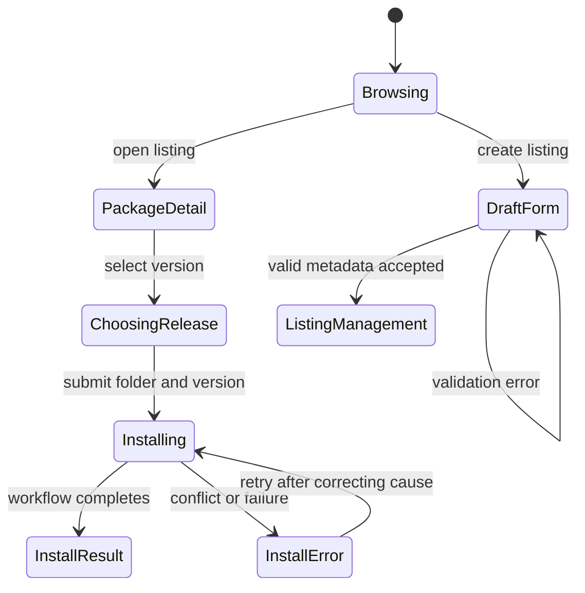

# Marketplace

## Summary

Marketplace lets users discover published automation packages, inspect listing details and releases,
install a selected release into a scoped workspace, and manage publisher listings. Browsing is
cursor-paginated. Installing is a durable ingestion workflow: choosing a version and folder starts
the operation, while conflicts or workflow failures can prevent completion. Publisher controls
create metadata-only drafts, edit listing metadata, add semantic-version drafts, publish versions,
and archive listings. The inspected management UI does not expose a file/artifact attachment action;
its copy says a named upload can be attached later. Do not treat draft metadata or a version record
as executable package content.

## The simple case

The user opens Marketplace in a scope. Published packages appear as cards with category, latest
version, summary, tags, publisher, and publication date. Selecting a card opens its package page,
where the user can read the artifact overview and select a release. Install opens an install tab for
the current scope. The default folder is `/workspace/{listing-slug}`; the user can change it and
submit. The UI then shows an installation-starting state and follows the workflow until it can
report the result and link to the installed folder.

The user can also create a private draft from the publisher workspace. The draft records slug,
initial version, name, summary, description, category, tags, and publisher organization. The page
explicitly states that creating this draft does not yet store files or executable package contents.
Listing management adds metadata editing, draft-version creation, publishing/restoring a selected
version, cursor-paginated older versions, and archiving. Although the UI copy refers to a named
upload that can be attached later, the inspected publish/manage screens contain no attachment
control; the available attachment flow and artifact prerequisites remain an open question. Scope and
access boundaries are described in [Navigation and scope](../foundations/navigation-and-scope.md)
and [Identity and access](../foundations/identity-and-access.md); accepted versus completed work is
defined in [Persistence and asynchronous work](../foundations/persistence-and-async-work.md).

## The interaction, event by event

### Arrive

The browse route requires a signed-in user; otherwise it redirects to login with the destination
preserved. It decodes an optional cursor and rejects malformed cursors with a 400 response.
Published listings are returned in pages. If there are no published listings, the page states “No
published automations yet.” A “Show more automations” link appears only when another cursor page
exists.

A listing detail page shows category, name, summary, tags, publisher, updated date, version history,
and package tabs. A published version in the URL can display a success/reused notice. The Install
tab reflects the selected artifact version. If the user is not a member of an organization eligible
as the installation target, installation controls are unavailable and the page says to join an
organization.

### Leave untouched

Browsing and viewing versions do not install or publish anything. Selecting a version changes URL
state, and package tabs are URL-addressable. Cancel from the install form returns to the overview
tab without starting ingestion. Changing the package section or release retains the installation
draft while changing listings resets the detail component and its path state.

### Begin editing

On Install, the user chooses the version and an installation folder under `/workspace`. The folder
field is checked against the marketplace installation-root rules on submit; invalid paths stay in
the form with an error alert. The selected release and target scope are sent to the scoped
organization automation service. The UI captures an analytics event when available as the
installation begins.

For publishing, the user enters metadata and chooses an organization. The route defaults to the
requested owner organization if it belongs to the user, else the active organization if available.
The action checks the selected organization and publisher authority, parses the metadata, and
creates or reuses a private draft. Empty/malformed required values return an error message; a
successful draft redirects to listing management with a result marker.

### While editing

When installation submission is pending, the detail page shows “Starting installation”. If the
submission is accepted, the UI attaches to the installation workflow and displays its
progress/result. Installations use the selected version and root. Conflicting files stop the
installation; a lock file records the release and folder on successful install. The lock-file name
is shown in the UI as `MARKETPLACE_LOCK_PATH`; the exact literal path should be verified from the
constant before reproducing it elsewhere.

The action can return a failure before a workflow begins, for example if no valid organization
target exists, no version is provided, the folder is invalid, or ingestion admission fails. These
errors are shown on the install surface. Publisher management separately edits listing metadata,
adds draft versions, publishes/restores versions, and archives listings. It has no visible artifact
upload control in the inspected route.

### Submit

A successful install request restarts or creates marketplace ingestion for the selected listing,
scope, root, and version, then redirects back to the package route carrying installation state.
Workflow completion is separate from request acceptance. On success the installation result offers a
link to the installed folder in Files. The workflow may fail after admission; the user can see that
outcome and decide whether to retry.

A successfully created draft redirects to Manage listing. If the requested version already exists,
the page can report reuse rather than claiming a new version was created. In management, metadata
saves return to the listing with an update notice; adding a semantic version creates or reuses a
draft version; publishing a draft makes it public, while restoring is offered for the latest
published version of an archived listing. Archive removes a listing from the public marketplace.
Notices distinguish newly completed operations from repeated/reused outcomes. The management page
does not show a confirm step before Archive listing, so treat it as an immediate action.

## Modifiers

| Variant                                             | At arrival                                                                                                    | During editing                                                                                            |
| --------------------------------------------------- | ------------------------------------------------------------------------------------------------------------- | --------------------------------------------------------------------------------------------------------- |
| Scope kind: personal, organization, project, system | Determines the install target and the available marketplace view.                                             | Switching scope changes target context; install authorization is checked server-side.                     |
| User authority                                      | Determines listing access, publisher organization, and ability to install/manage.                             | The action revalidates publisher/installation authority; visible controls are not a grant.                |
| Record/workflow state                               | Published listing versions and existing installation reference determine selected release and workflow state. | Version/root changes affect the proposed install; conflicts or an existing workflow can alter completion. |
| Browser/network state                               | Listing pages require requests; installation workflow needs synchronized collections and network.             | Failure can leave an accepted installation still running; re-open the listing to reconcile.               |

Changing listing identity resets the local install folder draft; changing the package tab or release
preserves it as long as the route remains within that listing.

## Cancel and interrupt

| Event                         | Before editing                                                                                                             | During operation                                                                                                     |
| ----------------------------- | -------------------------------------------------------------------------------------------------------------------------- | -------------------------------------------------------------------------------------------------------------------- |
| Explicit cancel               | Install Cancel returns to Overview without an ingestion request; leave a draft form without submit and nothing is created. | No general rollback for already admitted ingestion; close the result view only dismisses it.                         |
| Navigate or switch            | Leaving browse/detail does not publish or install.                                                                         | Navigation may stop observing the workflow; the durable ingestion can continue.                                      |
| Competing completion          | No pending action.                                                                                                         | Repeated install uses restart-or-create semantics; exact duplicate behavior depends on the same target/version/root. |
| Request failure               | Invalid cursor/list load uses route error behavior.                                                                        | Admission failure is displayed; a network disconnect after acceptance may leave an unknown outcome.                  |
| Page termination              | URL preserves listing/version/tab state.                                                                                   | Closing the tab does not guarantee cancellation of the admitted workflow.                                            |
| Target change                 | Listing may be withdrawn or become inaccessible.                                                                           | Files may conflict or scope authority may change before ingestion completes; workflow/action reports failure.        |
| Browser/input change          | Folder input accepts text; browser autofill is disabled.                                                                   | Losing focus does not roll back a workflow; invalid folder is checked before submit.                                 |
| Feature-specific state change | Listing version may be published/reused while page is open.                                                                | Workflow completion, conflict, or retry status changes the result surface.                                           |

After an interruption, inspect the workflow/reference and Files workspace before retrying.
Installation is durable asynchronous work and can leave effects already completed before a later
error; do not assume cancel reverses them.

## Interactions with other systems

**Permissions.** Marketplace routes require a signed-in user. Installation target and publishing
authority are validated for the selected organization/scope.

**Persistence/history.** Listings, versions, installation references, workflow instances, workspace
files, and an installation lock file are separate persisted records. URL query parameters preserve
selected versions/tabs and result notices.

**Parent scope.** Install targets the selected personal/org/project context, but the current action
resolves a permitted organization for ingestion. The installed folder is rooted under `/workspace`.

**Readonly/restricted state.** Published package browsing is read-only. Draft creation requires a
publisher organization; install requires an eligible organization and writable workspace.

**Offline.** Browsing, install admission, workflow progress and file transfer depend on
network/service availability. No offline install queue is established.

**Collaboration/multiple tabs.** Concurrent installations can target the same folder; conflict
handling and lock reconciliation are covered by marketplace workflows, not by tab-local UI state.

**Notifications.** Errors and publication/install outcomes appear inline. No email notification is
implied by creating a draft; marketplace analytics events are separate from user notifications.

**Preferences and URL state.** Listing ref, package tab, published version, version-history cursor,
installation root/reference, and browse cursor can be URL state. The install folder local draft is
retained across tab/version changes within the same listing.

**External integrations/side effects.** Installation transfers listing artifact files into scoped
workspace storage and may invoke durable workflow processing. Publishing exposes an artifact version
to marketplace users; only metadata draft creation does not publish.

**Accessibility and analytics.** Install folder errors use an alert role, installation start uses a
polite live region, and version history has an accessible selected-version label. Analytics records
install start/admission, not content. Verify keyboard use and progress announcements manually.

## Edge cases

- No published packages yields an explicit empty state.
- Invalid pagination cursor is a 400 response, not an empty listing page.
- The install folder must pass a schema check and is constrained to the workspace path.
- Conflicting files stop installation; a lock file records the installed release/root.
- The install UI has a distinct “starting” state while collection/workflow data initializes.
- The action may admit a restart-or-create workflow, so a server response is not equivalent to
  completed installation.
- Draft creation and adding a draft version can reuse an existing version; result query state
  distinguishes created versus reused.
- Listing identity changes reset the local folder draft, while tab/version changes retain it.
- Artifact details and version history paginate independently from published listing cards.
- Archive is available for non-archived listings and has no confirmation dialog in the inspected
  management view; archived listings can offer Restore listing for their latest published version.
- Metadata and semantic-version records do not by themselves provide package contents; the UI refers
  to a later named upload but exposes no such control in the inspected screens.

## Open questions and verification

- Reviewed `marketplace/detail.tsx`, `publish.tsx`, `browse.tsx`, and `manage.tsx`; scenario
  coverage and deeper artifact ingestion behavior still require a focused pass.
- The publish/manage routes inspected provide metadata/version/publish/archive actions, but no named
  artifact upload control. Locate the actual artifact attachment capability (if any) before
  documenting how executable content enters a listing.
- Verify install folder validation, conflict response, workflow completion/result, lock-file
  placement, failure recovery, and newly published/reused notices with a disposable listing and
  scope.
- Browser reconnaissance did not visit Marketplace or start any install/publish operation.

Verified against /Users/wilco/dev/fragno commit `7dd3c31b5`.
