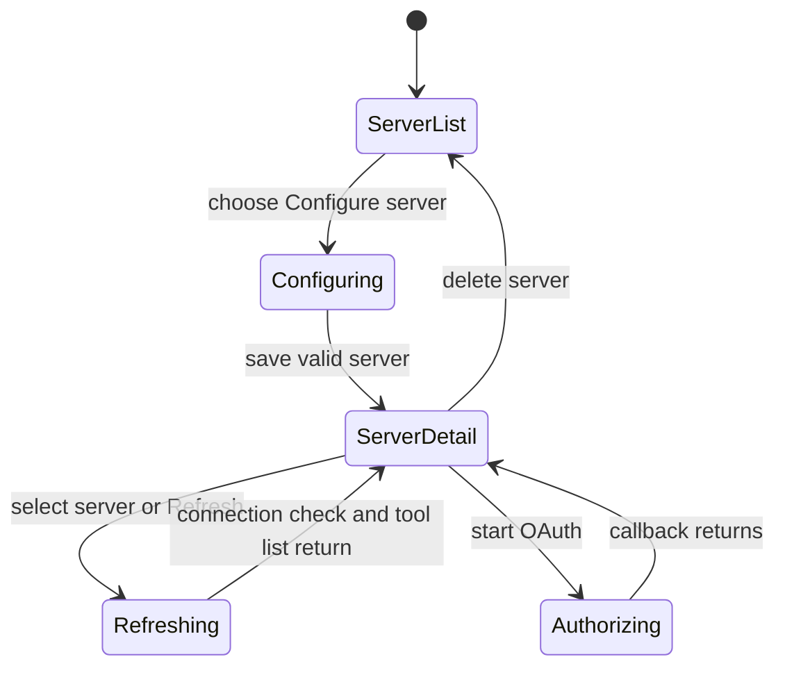

# MCP servers

## Summary

The Automations → MCP page registers remote streamable HTTP MCP servers in the selected scope,
stores their authentication method, checks connectivity, and displays the server's advertised tools.
A server can use OAuth, bearer-token, or no authentication. Selecting a server can automatically
start a connection check and refresh its tool cache. The user can create, inspect, refresh,
authorize, update credentials, or delete a server.

## The simple case

The user opens MCP and selects Configure server. They enter a slug and endpoint URL, optionally a
display name, and select OAuth, Bearer, or No auth. After saving, the server appears in the list.
Selecting it shows connection details and cached tools; the page starts a refresh to check the
remote server and reload the tool cache. The user can then use available tools from automation
runtime contexts, subject to scope permissions.

## The interaction, event by event

### Arrive

The route loads configured servers for the current scope and reports a server-list error if they
cannot be read. The left panel shows total count, Configure server, and each server's name/slug,
endpoint URL, and auth mode. If no servers exist, it says “No MCP servers configured yet.”

The configuration form defaults to OAuth. Slug and endpoint URL are required; the endpoint is a
streamable HTTP MCP URL. OAuth accepts optional client ID, client secret and scopes; Bearer requires
a token; No auth stores no credential. On server selection, the page can immediately show cached
tools and trigger a live refresh. If none are cached, it says they will appear when refresh starts;
an empty advertised tool list has its own “No tools advertised” state.

### Leave untouched

Opening the server list or selecting a server does not invoke a tool. Selecting a server can
automatically refresh connection status and tool cache, but does not call an advertised tool.
Opening Configure server does not create a record until submit.

### Begin editing

Saving a server sends slug, endpoint URL, optional name, and chosen auth configuration. A successful
response shows “MCP server configured.” A failure remains on the form with an error. OAuth setup may
separately start authorization and return an authorization URL; the user opens that page,
authorizes, then returns to the scoped MCP view. The callback outcome is represented by
`oauth=success` or `oauth=error` in the route query.

The server detail offers Refresh. Refresh checks connectivity and refreshes the advertised-tool
cache. A successful check says “Connection check passed and tool cache refreshed”; a failure shows
the provider error. Bearer auth can be replaced with a new token. Deleting a server is a separate
action.

### While editing

Refresh state is associated with the selected server. Cached tools may remain visible while the live
refresh runs or fails; the page chooses returned live tools when present and otherwise can fall back
to cached tools. Selecting a server automatically triggers at most one auto-refresh per selected
slug during the current mounted flow, except while configuring.

OAuth consent status, save errors, save success and refresh errors are presented inline. Server
selection and configure state are URL-driven. The page may show no tools when the endpoint responds
successfully with an empty list, distinct from no cache/refresh pending.

### Submit

Saving creates the server configuration. OAuth callback stores authorized credentials when
successful; an error state says OAuth could not be completed. Refresh reports its result and updates
cached tools. Delete removes the MCP server configuration. No separate confirm is visible in the
inspected delete form; users should treat the action as immediate once submitted.

Calling an MCP tool is not done by selecting it on this configuration screen; tool execution occurs
from automation/runtime surfaces and may cause external effects.

## Modifiers

| Variant                                             | At arrival                                                                                       | During editing                                                                          |
| --------------------------------------------------- | ------------------------------------------------------------------------------------------------ | --------------------------------------------------------------------------------------- |
| Scope kind: personal, organization, project, system | Selects the MCP server collection and which operations are available.                            | Scope switch changes the server list/authority boundary.                                |
| User authority                                      | Determines whether servers can be read, created, refreshed or deleted.                           | Every action is checked in the selected scope.                                          |
| Record/workflow state                               | Existing server, auth mode, cached tools and remote connection status determine visible details. | Refresh/OAuth state changes the connection and tool display.                            |
| Browser/network state                               | Remote service and local route data determine list availability.                                 | Refresh/OAuth/network failure shows errors; a timed-out refresh may leave cached tools. |

OAuth, Bearer, and No auth alter which credential fields appear; the choice is made before saving.

## Cancel and interrupt

| Event                         | Before editing                                                  | During editing                                                                                        |
| ----------------------------- | --------------------------------------------------------------- | ----------------------------------------------------------------------------------------------------- |
| Explicit cancel               | Navigate away from Configure server without saving.             | No rollback after server create/delete or remote authorization is accepted.                           |
| Navigate or switch            | Browse another server or section without calling tools.         | Leaving may stop seeing refresh/callback result; server remains configured.                           |
| Competing completion          | No mutation pending.                                            | A pending form submit is tracked; refresh may operate independently through a fetcher.                |
| Request failure               | Server-list loader shows its error.                             | Save/refresh returns inline failure; retry only after checking remote/server state.                   |
| Page termination              | Unsaved form fields are not guaranteed to persist.              | OAuth/refresh can complete remotely while the page is closed.                                         |
| Target change                 | Server can be removed or endpoint changed elsewhere.            | Stale selection can become missing; new refresh may fail.                                             |
| Browser/input change          | Provider authorization depends on browser redirect and cookies. | Network or popup/redirect behavior can interrupt OAuth; no recoverable local transaction is promised. |
| Feature-specific state change | Server may have cached tools but no current connection.         | Remote server changes tool list or auth state; refresh reveals updated state or error.                |

After uncertain OAuth/refresh results, reload the server detail and check auth status and tool
cache. Deleting configuration does not undo external provider-side app registration.

## Interactions with other systems

**Permissions.** Scope authorization gates server reads, creation, refresh, auth updates, and
deletion.

**Persistence/history.** Server config, stored auth and cached tool list persist in the scoped MCP
service. The current refresh result and alerts are page state.

**Parent scope.** Each MCP server belongs to System, organization, project, or personal scope
according to the route and capability policy.

**Readonly/restricted state.** Tool inspection may be allowed when creating/deleting servers is not;
server capabilities do not grant user authority.

**Offline.** Server setup and refresh require network. Cached tools can be displayed without a
successful current refresh, but their freshness is not guaranteed.

**Collaboration/multiple tabs.** Another operator can modify or delete a server; refresh/reload
reconciles the view.

**Notifications.** Save, OAuth, and refresh outcomes appear inline. No separate notification is
established.

**Preferences and URL state.** Selected server, configure mode and OAuth result are encoded in query
parameters.

**External integrations/side effects.** Remote MCP server calls, OAuth authorization, and later tool
invocations have external effects.

**Accessibility and analytics.** Server form uses labeled fields; status/error messages are visible.
Verify keyboard access to auth tabs, server list, and refresh result announcements.

## Edge cases

- A server can be saved even when OAuth authorization still needs to be completed.
- A successful refresh with zero tools differs from refresh failure and from no cache while refresh
  has not run.
- The list can show cached tools while live refresh returns an error.
- Server slug is the stable identifier used for actions and route state.
- OAuth success in provider redirection is distinct from successful Backoffice credential storage.

## Open questions and verification

- Browser pass did not configure an MCP server or contact an external endpoint. Test with a
  disposable streamable HTTP MCP service.
- Confirm whether delete requires additional confirmation in the shared UI and whether a connection
  status refresh can race with credential changes.
- Review MCP route scenarios for tool cache expiry, OAuth callback replay, and endpoint error
  presentation.

Verified against /Users/wilco/dev/fragno commit `7dd3c31b5`.
