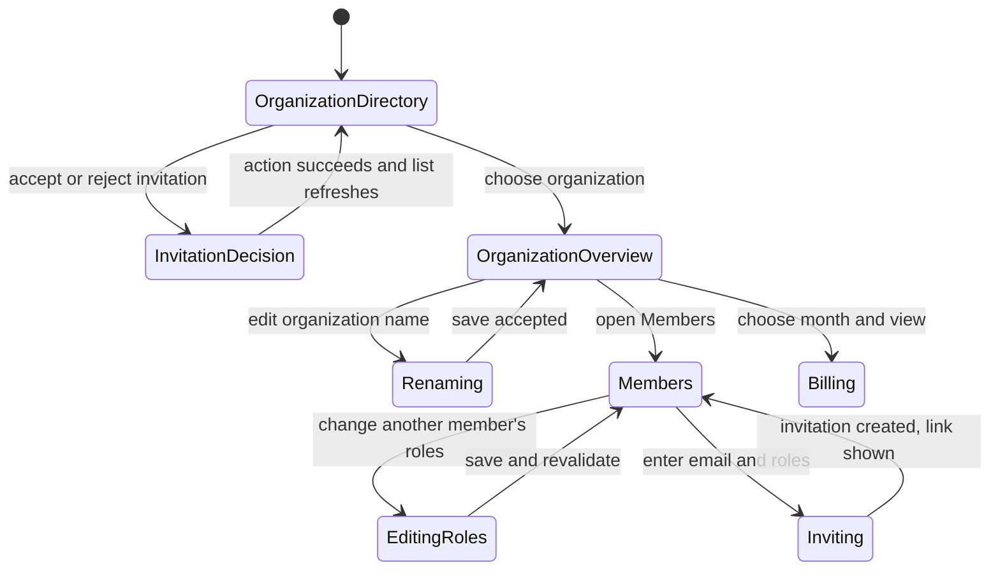

# Organizations

## Summary

The Organizations area lets users select among their organization memberships, accept or reject
invitations addressed to them, and manage each organization's overview, roster, invitations, and
usage statement. Account owners/admins can rename the organization, edit other members' roles,
remove members, and invite people. Billing presents organization usage counters by UTC month; it is
an estimated usage statement, not a payment-method or subscription checkout screen. Shared
membership and permission boundaries are defined in
[Identity and access](../foundations/identity-and-access.md), and scope switching in
[Navigation and scope](../foundations/navigation-and-scope.md).

## The simple case

From the account menu, the user opens Manage organizations. The directory lists their organizations,
their roles, and which organization is active/preferred. It also lists open invitations addressed to
their account. The user can open an organization to its overview, then move among Overview, Members,
Invites, and Billing.

The overview shows the organization name, slug, active/idle status, the current user's roles, and
creation date. An authorized owner/admin can rename it. Members shows a paginated roster with local
search and role management. Invites creates a shareable invitation link, but does not email it
automatically. Billing shows one selected month, total estimated cost, and recorded measurement
rows.

## The interaction, event by event

### Arrive

The organization directory uses the signed-in user's membership list, sorts organizations using a
stored preferred-organization choice, and loads invitations addressed to the account. Each
invitation shows organization, proposed roles, sent time, expiry, and actions. If there are none,
the page says “No open invitations.”

Organization routes are nested under `/backoffice/organizations/:orgSlug`. The overview route shows
details and an editable name only to a global admin or an organization owner/admin. Members and
Invites show management controls only to that same effective manager category. Billing reads a
period from the URL query; if absent it chooses the current UTC month. A supplied period that fails
validation produces a 400 response.

### Leave untouched

Viewing the organization directory or any organization tab does not change membership or
organization data. Invitation rejection first opens a confirmation. Canceling it leaves the invite
untouched. A member search filters only the current page's loaded roster; pagination changes the
`page` query and is disabled while route data loads or at the first/last page.

Billing period selection is a GET form. Choosing a month and pressing View changes the query string;
Previous and Next links change periods. There is no mutation from browsing the statement.

### Begin editing

Rename starts with the current organization name. The input is trimmed for comparison and
submission; Save is disabled when the trimmed value is empty, unchanged, unauthorized, or a save is
already pending. The organization slug is displayed but the UI action changes the name only.

For invitations, the default role is `member`. The manager enters an email and toggles roles, then
selects Send invite. An empty trimmed email is rejected locally. The invitation form resets its
email and roles to the initial default after success. The UI generates a shareable invitation URL
from the returned invitation ID and offers Copy link; clipboard failure is silently ignored. The
page explicitly warns invitations are not emailed automatically.

For role editing, managers can modify only another member, not themselves. Role selection stays
local until Save; Save is ignored for unchanged or empty selections. Removal is a separate action.
Before relying on any destructive confirmation behavior, verify it in the route UI.

### While editing

Mutations show feature-specific pending states: “Saving…”, “Sending…”, or the active
invitation/member action. On successful organization rename, invitation response, role update, or
removal, route data is revalidated and a success notice appears where the component implements one.
Errors are displayed from the action failure. The organizations screen may show a
preferred-organization notice after switching the active organization and revalidating.

Billing figures are derived from the selected statement. Cost quantities use nano-USD converted to
USD; other meters display integer quantities. Rows include meter, quantity, event count, first-seen
and last-seen time. Timestamps and statement periods are rendered in UTC. The future Next link is
omitted when its period would exceed the current UTC period.

### Submit

An accepted invitation adds the user to the organization and refreshes the directory. A rejected
invitation is declined and removed from the open-invitation list. A role change updates the selected
member's roles and refreshes the roster. A removal removes the member from the organization after
server acceptance. A successful invite creates a pending invitation; it displays the link so the
manager can share it through another channel. No email is sent automatically by this page.

A successful rename changes the organization name used throughout Backoffice and invitations and
revalidates the displayed data. Billing's View action submits a query-only navigation and returns
the selected statement. The statement is described as estimated total and recorded measurements; do
not treat it as a finalized invoice or charge without separate evidence.

## Modifiers

| Variant                                             | At arrival                                                                                              | During editing                                                                                     |
| --------------------------------------------------- | ------------------------------------------------------------------------------------------------------- | -------------------------------------------------------------------------------------------------- |
| Scope kind: personal, organization, project, system | Organization directory lists memberships; an organization tab targets the chosen org.                   | Choosing another organization changes active/preferred context or navigates to its route.          |
| User authority                                      | Global admin or org owner/admin can manage; other members may read but have restricted controls.        | Requests are checked by the server; role changes to one's own member row are disallowed in the UI. |
| Record/workflow state                               | Existing membership, invitation status, period, and roster pagination determine displayed actions/data. | Stale invitation/member state can make an action fail; saving unchanged data has no effect.        |
| Browser/network state                               | Loaders require authenticated data and billing/runtime services.                                        | Mutations can fail; invitation copy depends on clipboard permission.                               |

Invitation role selection defaults to `member`; organization manager authority is not a form
modifier users can choose for themselves.

## Cancel and interrupt

| Event                         | Before editing                                                                      | During operation                                                                                        |
| ----------------------------- | ----------------------------------------------------------------------------------- | ------------------------------------------------------------------------------------------------------- |
| Explicit cancel               | Cancel invitation rejection confirmation; do not submit other forms.                | No general undo after server acceptance. Clipboard copy failure leaves the invitation valid.            |
| Navigate or switch            | Leaving a page without submitting does not change organization or membership.       | Route revalidation or navigation may stop observing a mutation that the server already accepted.        |
| Competing completion          | No mutation pending.                                                                | Pending UI disables/serializes relevant invitation and role actions; simultaneous admin edits may race. |
| Request failure               | Loader error/invalid period uses route error handling.                              | Error notice or hook error is shown; reload/revalidate to confirm actual state before retrying.         |
| Page termination              | Local unsaved name/role/invitation fields are not established as persisted.         | Closing/reloading may hide the result while the server mutation has already committed.                  |
| Target change                 | Membership or invitation can expire/change between load and action.                 | Another manager may alter roles or remove the target; server result is authoritative.                   |
| Browser/input change          | Autofill/search behavior is browser-specific; clipboard not needed until Copy link. | Clipboard permission failure is ignored; network failure can interrupt server actions.                  |
| Feature-specific state change | Active/preferred organization can differ from the currently viewed org.             | Membership update or invitation response can change available routes and scopes.                        |

After an interruption, refresh the organization directory or roster before retrying. The directory's
visible preferred badge and active route are separate concepts; the route remains the source of
current page context.

## Interactions with other systems

**Permissions.** Management controls are available to global admin or organization owner/admin;
server authorization remains authoritative. Settings displays effective base grants but notes that
action/resource policies may further deny access.

**Persistence/history.** Organization names, membership, roles, and invitation states persist
server-side after accepted actions. Search is local to the loaded page; pagination and billing
period are URL state. No undo is presented.

**Parent scope.** Members, invites, overview and billing belong to the organization URL. The account
menu links into the active organization's pages.

**Readonly/restricted state.** Non-manager users can see the explicit requirement “Admin or owner
access required” where management controls are unavailable. The interface may still show read-only
roster/overview data.

**Offline.** Invitation, rename, role, removal, organization-switch, and billing loads require
network/server availability. No offline mutation queue is established.

**Collaboration/multiple tabs.** Membership can change from another manager or tab. Successful
actions revalidate the current route; a stale local role selection may be rejected.

**Notifications.** Invitation creation produces a link and success message but does not email
automatically. Membership changes may emit analytics events; analytics is not a user notification.

**Preferences and URL state.** Preferred organization is stored client-side and used to sort/resolve
organization context. Member page and billing period use query parameters. Member search is
component state and resets on organization change.

**External integrations/side effects.** Invitation email delivery is explicitly not automatic from
the invite form. Billing data comes from organization-scoped usage measurements; external payment
behavior is not shown here.

**Accessibility and analytics.** Search has an accessible label; organization member
updates/removals and invitation creation have explicit analytics events when available. Verify table
navigation, role controls, confirmation and copy feedback manually.

## Edge cases

- Invitation response uses confirmation only for Reject; accepting is immediate after activation.
- Invitations are addressed to the signed-in account and can have an expiry.
- Invite roles can be toggled to none; the action passes `undefined` when no roles remain, leaving
  server defaults/policy to determine the result.
- The invite link is shown only if the create response includes an invitation ID.
- The Copy button reports “Copied” briefly; clipboard errors are swallowed without an inline error.
- Member search covers only the current page, not every organization member.
- Member Save does nothing if selection is unchanged or empty.
- Billing period is a UTC `YYYY-MM` month; future periods are not offered by the Next link.
- A statement can have zero trackers and shows an explicit no-measurements state.

## Open questions and verification

- The browser pass did not visit organization administration or use a disposable member account.
- Verify the full role table, member removal confirmation, invitation behavior for existing
  users/expired invites, invite-link copy permissions, and active/preferred organization behavior.
- Confirm statements are estimates and determine any billing product language before describing them
  as invoices, payment obligations, or finalized charges.
- Run the organization auth and billing scenarios before asserting error recovery and exact
  date/quantity formats beyond the visible component behavior.

Verified against /Users/wilco/dev/fragno commit `7dd3c31b5`.
