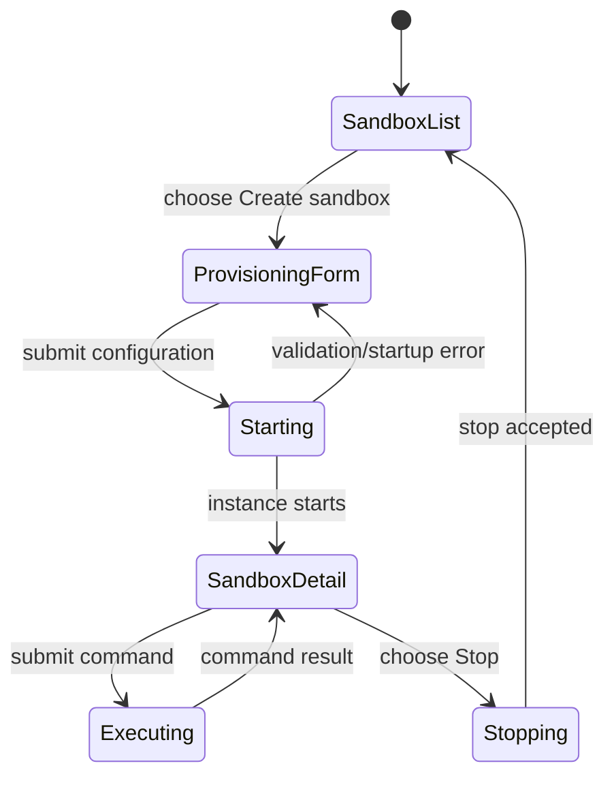

# Sandboxes

## Summary

The Sandboxes page provisions isolated Cloudflare sandbox instances in the selected automation
scope, runs a startup command, executes shell commands against a running instance, displays their
stdout/stderr/exit result, and stops instances. Sandbox records have transitional states such as
requested, starting, and stopping; the page periodically revalidates while one of those states is
present.

## The simple case

The user opens Automations → Sandboxes. A left-hand list shows existing instances and their status;
Create sandbox opens a form. The user may supply an ID or leave it blank for an auto-generated
normalized ID, set an idle sleep timeout, startup command and timeout, and choose Keep alive. Start
sandbox provisions the runtime and runs the startup command. Once an instance is running, the user
can execute a command and inspect output or stop the instance.

## The interaction, event by event

### Arrive

The loader checks scope access and lists sandbox instances. If loading fails, the page shows “Could
not load sandbox instances” and hides the ordinary list. Otherwise the route uses query parameters
`view=new` or `view=detail` and `sandbox` to choose the panel. If the URL requests a missing
instance, a Missing sandbox state offers Create new sandbox. Without an explicit valid selection,
the page selects a non-stopped instance if available, otherwise the first instance, otherwise the
new-sandbox view.

The create form offers optional ID, Sleep after, Startup command, Startup timeout (ms), and Keep
alive. Sleep after accepts duration text such as `15m` or a seconds value such as `900`. Startup
command defaults to `true`; Keep alive reflects the form default. The detail page shows status,
Stop, and command runner. Command execution is enabled only while status is Running.

### Leave untouched

Opening the list, selecting an instance, or filling the create form does not provision a sandbox.
Selecting an instance changes query parameters. The command runner does not execute until Run
command is submitted. Stop is an explicit instance action.

### Begin editing

Start parses sleep timeout and positive integer startup timeout. If ID is blank, the server
generates one; IDs are normalized. Start launches provisioning with keep-alive policy, sleep timeout
and startup command. An empty startup command is replaced with `true`. If startup fails after an
instance was created, Backoffice attempts to stop the partial instance; cleanup failure is logged
and the user receives the startup error with the original form values retained.

The command runner requires a nonempty command. Optional timeout must be a positive integer. It runs
one command exactly as entered; the app does not split the textarea into multiple commands. The UI
allows a timeout input; blank uses the runtime default. A command is only submitted for a currently
running selected sandbox.

### While editing

Sandbox statuses requested, starting, and stopping cause the route to revalidate after a one-second
delay when no revalidation is already active. This lets the list transition to a stable state
without manual refresh. A command action returns stdout, stderr, exit status, error reason and
retryability where available. If the sandbox exits before completion, the result can be marked
terminated and retryable.

While a command is executing, its button says “Running…” and is disabled. While Stop is pending, its
button says “Stopping…”. Command results are associated with the selected instance; changing
selection does not make a prior result appear under another sandbox. A stop failure is shown inline.

### Submit

A successful start redirects to the new instance's detail route. A failed startup remains on the
form, displays an error, and retains submitted values. A successful command result appears in the
Output panel. A failed command can still include stdout/stderr and a structured reason; a thrown
internal action failure is marked non-retryable by this route. Stop success redirects to the
new-sandbox view. Stop failure keeps the current detail view and shows the error.

## Modifiers

| Variant                                             | At arrival                                                                                            | During editing                                                                                       |
| --------------------------------------------------- | ----------------------------------------------------------------------------------------------------- | ---------------------------------------------------------------------------------------------------- |
| Scope kind: personal, organization, project, system | Selects which sandbox instances and runtime are available.                                            | Switching scope navigates to another sandbox collection.                                             |
| User authority                                      | Scope check gates access to list/start/exec/stop actions.                                             | Server checks authority at each action; existing view is not a lasting grant.                        |
| Record/workflow state                               | Requested/starting/running/stopping/stopped status determines default selection and enabled controls. | Commands require running; state changes trigger periodic revalidation.                               |
| Browser/network state                               | Loader and sandbox provider availability determine whether instances load.                            | Provider errors can fail startup/command/stop; an accepted start can continue after page navigation. |

Keep alive, sleep timeout, startup command and timeout are chosen on provision; changing them does
not retroactively reconfigure an existing sandbox in the displayed workflow.

## Cancel and interrupt

| Event                         | Before editing                                             | During editing                                                                                                        |
| ----------------------------- | ---------------------------------------------------------- | --------------------------------------------------------------------------------------------------------------------- |
| Explicit cancel               | Navigate away from create form; no instance is created.    | Stop submits a kill request; it does not cancel a command already executed.                                           |
| Navigate or switch            | Changing view or selected instance changes URL state only. | Server provisioning/command may continue while the browser leaves.                                                    |
| Competing completion          | No action is pending.                                      | Start/exec/kill controls track their own pending intents; duplicate behavior beyond disabled buttons is not promised. |
| Request failure               | Loader shows a sandbox-list error.                         | Start/exec/kill shows errors; check instance state before retrying after a lost response.                             |
| Page termination              | Unsaved config stays local.                                | Closing the page does not guarantee sandbox or command termination.                                                   |
| Target change                 | Missing sandbox ID produces a not-found state.             | Instance may stop externally during a command; result may be terminated.                                              |
| Browser/input change          | Form inputs are standard browser controls.                 | Network loss can hide command output while the process already ran.                                                   |
| Feature-specific state change | Existing transitional status can be selected.              | Revalidation observes startup/stop transitions; provider may mark failure or termination.                             |

After a command request has been sent, treat it as potentially executed even if no result is
displayed. Inspect the sandbox before retrying commands with side effects.

## Interactions with other systems

**Permissions.** The route checks scoped sandbox access for each operation.

**Persistence/history.** Instance state is maintained by the sandbox runtime. The page shows the
most recent command result for the selected instance, not a full command-history log.

**Parent scope.** Sandbox instances are automation-scope specific.

**Readonly/restricted state.** A user can inspect instances without necessarily having authority to
start, execute, or stop them.

**Offline.** Provisioning, execution and stop require the sandbox provider; there is no offline
queue.

**Collaboration/multiple tabs.** Another actor can stop or change an instance. Revalidation
refreshes transitional state, but concurrent command output is not a shared terminal transcript.

**Notifications.** Status/error/result messages are shown in the page. No separate notification is
established.

**Preferences and URL state.** `view` and `sandbox` query parameters select create/detail state and
instance.

**External integrations/side effects.** Startup and submitted shell commands execute inside an
isolated external sandbox and can cause network or filesystem effects.

**Accessibility and analytics.** Inputs are labeled and command textarea has an accessible name;
status/error/output semantics need manual keyboard and screen-reader verification.

## Edge cases

- If startup succeeds partially but the action throws, the route attempts cleanup; cleanup itself
  can fail.
- Default startup command `true` means an omitted command still executes a successful no-op command.
- Invalid sleep duration returns the form with values rather than creating an instance.
- The detail command input requires nonempty text and only works while status is running.
- A sandbox ID in the URL that no longer exists shows a missing-instance view.
- Transitional revalidation is scheduled once per second while status is transitional and
  revalidation is idle.
- Result retryability depends on the typed runtime result; not every internal error is retryable.

## Open questions and verification

- No sandbox was started or command executed during browser verification. Use a disposable scope and
  a harmless command such as `printf test`.
- Confirm ID normalization, sleep parsing bounds, provider startup timeout, and whether stopped
  instances remain in the list through scenario tests.
- Verify output rendering, retryable result labels, cleanup failure, and periodic transition timing
  manually.

Verified against /Users/wilco/dev/fragno commit `7dd3c31b5`.
