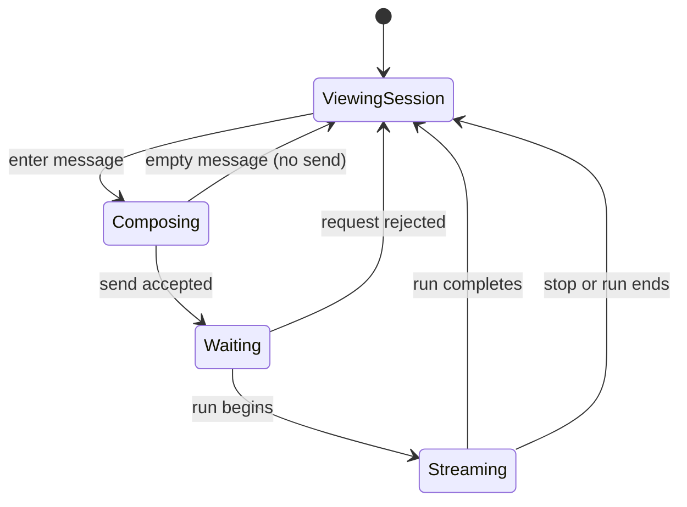

# Sessions

## Summary

Sessions let a user start and inspect persisted agent conversations in a personal, organization, or
project scope. A session detail page presents messages and execution activity, offers a composer,
and exposes controls for stopping a run, compacting context, and exporting the record. The session
list and detail routes live under `/backoffice/sessions`; a scoped detail route identifies both the
scope and session in its URL. Shared route/scope behavior is defined in
[Navigation and scope](../foundations/navigation-and-scope.md), and the distinction between
server-persisted results and pending work is in
[Persistence and asynchronous work](../foundations/persistence-and-async-work.md).

## The simple case

The user opens Sessions in the application shell and chooses a scope. The session list provides
entry points to existing sessions and a way to start a new one. Starting a session leads to a detail
view where the user can read prior entries and send a message. The assistant response appears as the
run progresses, with tool and workflow activity available in the session workspace.

When the run finishes, the user can continue the conversation, open a new session, change display
options, or export the session as JSONL. Exact list ordering, new-session defaults, model choice,
and empty-state copy depend on the loaded route data and are not generalized here without further
verification.

## The interaction, event by event

### Arrive

A session detail URL loads a persisted session and its entries within the route's scope. The page
identifies the session in its header and offers display options for tool calls, thinking, and usage,
along with an export link. The session's model label is resolved from available model options when
possible; otherwise the displayed label falls back to the model identifier.

Session data is not equivalent to an unsaved composer draft. The route can also carry an
`initialPromptError` query parameter; after the user submits a message, that error parameter is
removed with history replacement. The origin and exact presentation of that initial-prompt error
need verification.

### Leave untouched

Reading a session, opening its display options, or viewing the workspace does not submit a new
message. Opening another route leaves the detail page. The inspected code does not establish whether
unsent composer text is retained across route changes or reloads; users should not assume it is
persisted.

### Begin editing

Typing in the composer creates local message content. Submitting an empty or whitespace-only message
does nothing. A non-empty message is sent through the session action with an explicit busy policy:
if the session is already running, the current command kind is passed as `whenBusy`; otherwise the
request uses `reject`. The exact user-facing outcomes for all busy policies depend on the action
implementation and need confirmation against the matching route action and tests.

A submission disables sending while the submission request is pending. If an earlier initial-prompt
error is present in the URL, it is removed when the send is initiated. This URL cleanup is not a
guarantee that the send succeeded.

### While editing

While the agent is running, the session view can update with streamed output and execution entries.
The Stop control submits an abort intent. A second message while busy follows the selected busy
policy rather than being assumed to queue. The available implementation chooses the command kind as
that policy when already running.

Context compaction is a separate action. It is blocked while a run is active. The current composer
text, trimmed, is supplied as compaction instructions; the user may therefore submit compaction
instructions without sending them as a conversation message. After the server accepts a compaction
task, the page observes its status. Completion clears the composer text and returns the composer
action to “message”. An unchanged result shows a notice; a failed result shows an error. If
observation fails, an error is shown and the pending indicator is cleared. The polling interval and
timeout behavior are not established here.

The session workspace can open and close, and individual workspace items can be toggled only if the
item remains present. A newly available workflow workspace item may open automatically. Whether
local workspace open/selection state persists across reloads is not established in the inspected
excerpt.

### Submit

A successful message submission becomes part of the session and the agent run proceeds. The exact
point at which the user message is durably committed, how interrupted output is represented, and
whether the run continues after leaving the page are governed by session action/runtime behavior and
should be checked in the corresponding scenarios.

Stopping submits an abort request; it does not erase prior messages or prove that already completed
tool effects are rolled back. A run's terminal status and any partial assistant response remain
visible according to the session entry stream. Export downloads a JSONL representation named
`pi-session-{sessionId}.jsonl` from the session's export route.

## Modifiers

| Variant                                             | At arrival                                                     | During editing                                                                                      |
| --------------------------------------------------- | -------------------------------------------------------------- | --------------------------------------------------------------------------------------------------- |
| Scope kind: personal, organization, project, system | Selects the session collection and permission boundary.        | Switching scope navigates away from the current detail route; unsent composer retention is unknown. |
| User authority                                      | Determines whether the session can be read or acted on.        | Server authorization may reject an action even if the page was already open.                        |
| Record/workflow state                               | Session state determines available controls.                   | Running status changes the busy-message policy and disables compaction.                             |
| Browser/network state                               | Determines whether session entries and action routes can load. | Requests or live updates may fail; exact reconnection behavior needs verification.                  |

Changing the session/run state during editing can change available controls; a user should not
assume that send, compact, or stop remains valid until the server accepts it.

## Cancel and interrupt

| Event                         | Before editing                                                                                      | During operation                                                                                         |
| ----------------------------- | --------------------------------------------------------------------------------------------------- | -------------------------------------------------------------------------------------------------------- |
| Explicit cancel               | Empty submission is ignored; no message is created.                                                 | Stop submits abort for the active run. It does not imply rollback of completed tool effects.             |
| Navigate or switch            | Leaving the list/detail does not create a message.                                                  | Navigation may stop visible streaming; whether the run continues server-side is to verify.               |
| Competing completion          | No operation is in flight.                                                                          | A second send uses the configured busy policy; compact is unavailable while running.                     |
| Request failure               | A failed list/detail request uses route error handling.                                             | Send/compact/abort failure presentation and retry rules need verification.                               |
| Page termination              | Reload before submit does not create a server message; local composer draft persistence is unknown. | Reload/close may end the client stream observation; server run and partial state may remain. Verify.     |
| Target change                 | Deleted or inaccessible session may not load.                                                       | Concurrent session mutation or revoked access may make the action fail; outcome is server-authoritative. |
| Browser/input change          | Focus/autofill behavior has not been established for the composer.                                  | Focus loss alone is not documented as cancelling a run. Browser close/reload is covered above.           |
| Feature-specific state change | Session may already contain an active run when opened.                                              | Run completion, failure, or compaction status changes which controls and notices appear.                 |

After Stop, the user remains in the session detail view. The abort request's accepted/completed
distinction and resulting partial entry presentation require direct inspection and scenario review.

## Interactions with other systems

**Permissions.** Session visibility and actions are scoped; server authority is decisive.
Cross-scope access is not inferred from a session ID.

**Persistence/history.** Session entries are persisted separately from the unsent composer. Export
provides a JSONL download. Exact draft persistence and export boundaries need verification.

**Parent scope.** The route's personal, organization, or project scope determines the session
collection and navigation base path.

**Readonly/restricted state.** A user may be able to inspect a session without being allowed to send
or stop. Exact readonly affordances need a role-based check.

**Offline.** Sending, aborting, compacting, exporting, and streaming require successful requests;
offline queue/retry behavior is not established.

**Collaboration/multiple tabs.** Another tab or actor may change session state. The active-run
observation and conflict behavior across tabs need testing.

**Notifications.** No notification behavior for session messages is established here.

**Preferences and URL state.** Session ID and scope are in the route. The initial prompt error is a
query parameter. Display toggles exist for tool calls, thinking, and usage; persistence of these
preferences is not established.

**External integrations/side effects.** Agent tool calls can affect connected systems; stopping a
run does not imply that already-performed external effects are reversed.

**Accessibility and analytics.** Message submissions and compaction requests have explicit analytics
events when analytics is available; payload details exclude message content in the application's
documented analytics policy. Keyboard and screen-reader behavior needs manual verification.

## Edge cases

- Empty or whitespace-only message content is ignored.
- Sending while busy passes a policy derived from the current command kind; it is not safe to
  describe this as always queueing or always rejecting.
- Compact uses the trimmed composer text as instructions and clears the composer only when
  completion is reported.
- A compaction that reports “unchanged” is distinct from failure and produces a notice rather than a
  success-clearing path.
- The model label may show the raw model ID when no available-model label matches.
- Session history timestamps may differ between the server-rendered page and the browser's local
  timezone. The first direct visit emitted React hydration error #418; a later reload showed the
  same stored session at 1:40 PM instead of the earlier 3:40 PM. This looks like a product defect,
  not intended session-time behavior.
- A route's initial-prompt error query is removed when sending begins, not only after a successful
  response.
- Session display settings, workspace selection, and composer text may have different persistence
  lifetimes; do not treat them as one saved draft.

## Open questions and verification

- Read `session-detail.tsx` for the visible message, stop, compact, workspace, and export controls.
  Confirm the route action and scenario tests before documenting exact busy-policy results or commit
  timing.
- The browser reconnaissance did not open Sessions or submit a message; every user-facing detail
  beyond shared shell is code-derived and unverified visually.
- Verify stop behavior, mid-stream navigation/reload, busy send outcomes, compaction
  success/unchanged/failure, and whether the composer is cleared in each outcome.
- Verify which session view preferences and workspace state persist across reloads and scope
  switches.
- **Suspected defect:** server/client timezone mismatch in session history timestamp formatting
  causes hydration text mismatch and can shift displayed times by two hours. See
  [B-01](../bug-triage.md#b-01-session-history-timestamps-differ-between-server-and-browser).

Verified against /Users/wilco/dev/fragno commit `7dd3c31b5`.
