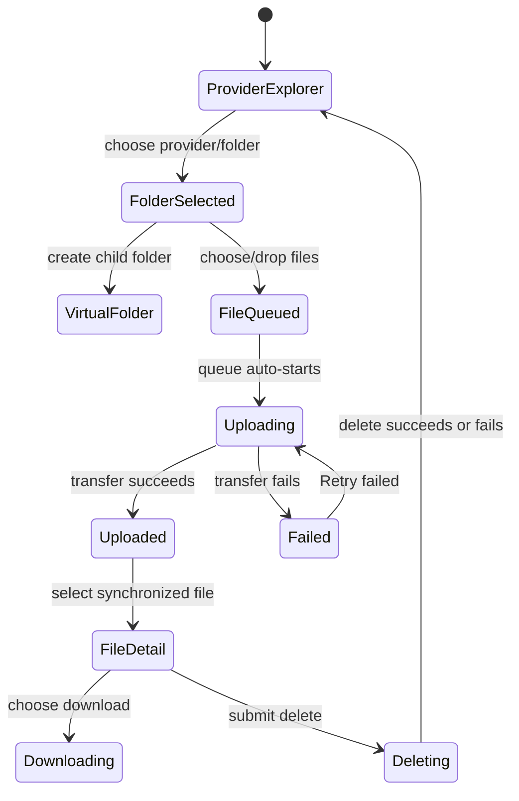

# Upload management

## Summary

The organization-scoped Upload connection has a Files workspace for browsing configured storage
providers, creating virtual folders, uploading files, inspecting metadata, downloading content, and
deleting files. The provider tree and local queue are distinct: folder creation is local/virtual
until a file is uploaded, while uploads transfer file bytes to the chosen provider and synchronize
metadata back into the explorer. The app supports Workspace, R2, and R2 remote providers when
configured.

## The simple case

An authorized organization member opens Connections → Upload → Files. They choose a provider root,
open or create a folder, and select or drag files into that target. Each queued file receives a
readable collision-safe key under the selected prefix and uploads sequentially with byte progress.
The synchronized tree updates when the uploaded file metadata becomes ready. Selecting a file shows
provider, status, size, content type, and timestamps, plus download and delete actions.

## The interaction, event by event

### Arrive

The route requires an organization and loads its Upload configuration. A configuration error is
displayed; if Upload is not configured, the route redirects to configuration. On the Files page, the
app initializes a browser database and live file metadata collection. While it is unavailable and
there are no rows, the view says “Loading local Upload file metadata…”; a sync error is shown above
the explorer while retained rows may still display.

Configured roots appear in Workspace, R2, and R2 remote order. Each tree shows file/folder counts;
folders can expand/collapse. The URL identifies root, folder, or file selection, provider, and
folder prefix/file key. The selected folder/root gives the upload target. Selecting a file instead
shows details and does not provide an upload target until the user returns to its containing folder.

### Leave untouched

Browsing roots/files and expanding folders does not modify stored files. Creating a folder adds a
virtual folder to the client view; the copy says it stays local until a file is uploaded into it.
Choosing or dropping files adds them to a client-side queue; upload begins automatically when
eligible. File selection can generate a download URL for R2 remote or download bytes through the
client for other providers. Deleting requires submitting Delete file.

### Begin editing

Create folder accepts a slash-delimited relative child path beneath the selected target. It rejects
empty segments, `.`/`..`, control characters, and empty names; it normalizes surrounding slashes and
preserves valid path nesting. The virtual folder is navigable immediately but is not a durable empty
storage directory.

Upload accepts multiple files. Each item records the browser `File`, original filename, byte size,
target provider, and selected prefix. It generates a key from a lowercased, safe filename stem, an
8-character random suffix, and a sanitized extension, then transfers with MIME type or
`application/octet-stream` fallback. Files in one batch run sequentially; files queued for other
folders remain queued until a matching target is selected and eligible.

File detail can download content, generate a signed URL for R2 remote, or delete. Download URL
generation is a server action; the displayed URL and expiry are shown when returned. Downloading
creates a browser Blob download. Deletion is a direct action form; no confirmation dialog appears in
the inspected component.

### While editing

Each upload card displays Queued, Uploading, Uploaded, or Failed, bytes transferred/total, a
progress bar, and an error message if one occurs. Retry failed resubmits failed items for the
current provider/prefix; Clear finished removes completed and failed queue cards for that target.
Pending/failed items in other folders are counted in a notice. The queue is React state in the page,
not durable server-side upload history.

Files are read from the synchronized local metadata collection with status `ready`; directory marker
records are omitted. A newly transferred file can take time to appear until metadata synchronization
updates the collection. File details can become stale if another actor deletes a file; then the page
says the selected file is no longer available and links to its containing folder.

### Submit

An upload completing marks the queue item Uploaded and records the file in the provider through the
upload client; it does not create a permanent upload-history entry in this page. Failed transfers
keep a Failed card with an error and can be retried. Create folder changes only local virtual-folder
state. Generate download URL returns a URL and expiry for the selected R2 remote file; Download file
retrieves content and starts a browser download. Delete success displays “File deleted.” and the
live metadata collection removes the file when synchronized; failure displays an error.

## Modifiers

| Variant               | At arrival                                                                                 | During editing                                                                                        |
| --------------------- | ------------------------------------------------------------------------------------------ | ----------------------------------------------------------------------------------------------------- |
| Organization          | Selects Upload configuration and storage namespaces.                                       | Switching organization navigates to another file collection and upload target.                        |
| User authority        | Organization route and Upload permissions determine access to config/files/actions.        | Server-side download URL and deletion operations can reject access at submission.                     |
| Record/workflow state | Configured providers, ready metadata and selected provider/folder/file determine controls. | Queue state and sync state change progress/availability; deleting elsewhere can make selection stale. |
| Browser/network state | Client database readiness determines explorer availability.                                | Upload/download needs network; browser termination can lose queue state and obscure transfer outcome. |

Provider configuration controls the available roots and download method; it is not changed by the
Files screen.

## Cancel and interrupt

| Event                         | Before editing                                                          | During editing                                                                                                           |
| ----------------------------- | ----------------------------------------------------------------------- | ------------------------------------------------------------------------------------------------------------------------ |
| Explicit cancel               | Leave folder form or selection without creating/uploading.              | No per-item cancel control is present after transfer starts.                                                             |
| Navigate or switch            | Selecting another URL-addressed folder changes the active target.       | Active transfer may continue in component while route remains; navigation/unmount can lose queue observation.            |
| Competing completion          | No mutation pending.                                                    | Uploads are serialized by the shared queue runner; current runner prevents a second run.                                 |
| Request failure               | Config/sync errors display in the view.                                 | Failed item retains an error and can be retried; delete/download errors are inline.                                      |
| Page termination              | Local virtual folder and queue are not guaranteed to persist.           | Transfer may complete remotely while the browser loses the result; reconcile by refreshing the provider tree.            |
| Target change                 | File selection is not a writable target.                                | Queue items retain their original provider/prefix even if user selects another folder.                                   |
| Browser/input change          | File chooser supports multiple files; dropping files is also supported. | Browser disconnect can interrupt transfer; whether a partial remote object remains is provider-dependent and unverified. |
| Feature-specific state change | Virtual folder has no persisted empty directory record.                 | Metadata may arrive after transfer; until status is ready the file is not in the visible tree.                           |

After an uncertain upload, refresh the explorer and check for the generated key before retrying; the
visible key includes a random suffix, so a second submission can create a second object. Delete is
not reversible from this screen.

## Interactions with other systems

**Permissions.** Organization access and Upload route operations determine who can inspect,
download, upload, or delete. Verify each action's exact permission separately.

**Persistence/history.** File bytes live in the selected provider; ready metadata is synchronized
through a local collection. Queue entries and virtual folders are transient page state, not file
history.

**Parent scope.** Upload management is organization-specific; the selected organization slug
determines the collection and upload client.

**Readonly/restricted state.** The explorer can show stored files while upload/delete controls may
be denied by policy.

**Offline.** Client metadata may remain locally available, but uploads/downloads/deletes require
service connectivity. There is no durable offline upload queue.

**Collaboration/multiple tabs.** Other actors can add/remove files. The synchronized collection is
the visible source; queue state is local to this page.

**Notifications.** Upload status cards and inline action messages provide feedback; no external
notification is implied.

**Preferences and URL state.** Provider, root/folder/file selection are URL query state. Queue,
virtual folders, open/closed folders and progress are local component state.

**External integrations/side effects.** Upload transfers to configured database/R2 providers; signed
downloads and deletion invoke provider operations.

**Accessibility and analytics.** Explorer uses a labeled nav; drop zone has a file input and queue
cards use progress semantics. Verify keyboard operation of file chooser, folder tree, and
clear/retry controls; drop itself should not be the only upload path.

## Edge cases

- The Files route redirects to configuration when Upload is not configured.
- Empty folders are virtual and exist only in the current browser state until an uploaded file
  creates a corresponding path.
- Folder names reject empty segments and dot traversal; normalized leading/trailing slashes are
  trimmed.
- Selecting a file removes the upload target until Open folder is used.
- Upload keys include an 8-character random suffix to avoid name collisions and use sanitized
  extension text.
- An empty/unknown MIME type is sent as `application/octet-stream`.
- Failed and completed queue cards are both removable using Clear finished.
- R2 remote uses signed URL generation; other providers download bytes through the client.
- Metadata synchronization failure can coexist with already-loaded rows.

## Open questions and verification

- Browser verification observed Workspace and Static roots in the Backoffice Files explorer (a
  distinct surface from organization-scoped Upload Files). This Upload Files route was not
  exercised.
- Verify provider-specific setup/permission requirements, transfer failure/partial-object cleanup,
  maximum file size/type constraints, signed URL expiry, and deletion propagation.
- Confirm queue loss on navigation/unmount and whether an in-flight transfer continues after the
  component is removed.

Verified against /Users/wilco/dev/fragno commit `7dd3c31b5`.
