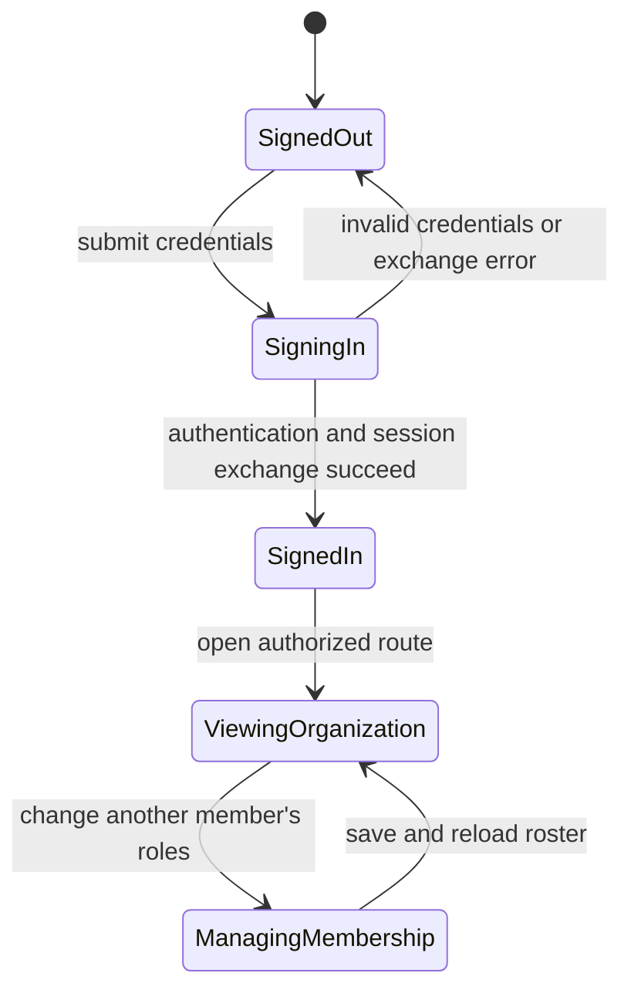

# Identity and access

## Summary

Identity and access determine who can enter Backoffice, which organizations and scopes they can see,
and which actions they can perform. Sign-in, invitation acceptance, organization membership and
roles all contribute to this boundary. The visible screen is an affordance; the server remains
authoritative for each protected operation.

## The simple case

A user signs in through the Backoffice login page with an email and password, then lands at the
requested Backoffice destination or the app's selected organization context. The login page can also
route through authentication bootstrap when the browser needs to establish the app session. Users
may have pending organization invitations; accepting an invitation adds membership, while rejecting
it requires a browser confirmation.

An organization member can view a roster and, if their own role permits it, manage other members'
roles or remove them. The interface excludes editing one's own membership in the member-management
view. Different operations may require different authority; “admin” in the global user account and
“owner/admin” in an organization are distinct signals and must not be conflated.

## The interaction, event by event

### Arrive

A signed-in route resolves the user's identity and requested scope before exposing protected data.
The login page accepts a normalized email and nonempty password. It can carry a safe return
destination and OAuth-related query state; authentication error codes map to user-facing retry
guidance. A successful sign-in may exchange the browser authentication session for a Backoffice
token, and organization provisioning can cause the server to ask the client to retry after a delay.

The organization directory shows the organizations available to the signed-in user and invitations
addressed to the account. The members route shows the roster for a selected organization with roles,
join information, pagination, and a search field. Users see the actions allowed by their authority,
but the server must validate every request independently.

### Leave untouched

Opening the login page, organization directory, or member roster makes no membership change by
itself. Rejecting an invitation is the exception to a simple submit: the app first asks
`Reject this invitation?`; canceling that browser confirmation leaves the invitation unchanged. The
member search filters the currently loaded page locally and is cleared when the organization
changes.

### Begin editing

On login, submission starts the authentication attempt. The input email is trimmed and lowercased
before validation; malformed or overlong email and empty password do not proceed as a valid sign-in.
Errors are shown as a user-facing message, including translated provider error cases where
applicable. Exact client-side feedback timing and loading label need browser verification.

On the members page, a manager can change selected roles for another member. The Save action is
effective only when roles differ from the current set and at least one role remains selected. A user
cannot edit their own roles through this screen. Role selection is local until Save is activated;
saving makes a request and revalidates the member data.

### While editing

Sign-in may be waiting on the identity provider, server session exchange, or organization
provisioning. These are pending states, not proof that the user is signed in. If authentication or
session exchange fails, the page presents a retry-oriented message and remains outside the protected
destination.

Invitation accept/reject requests mark an invitation action as in progress and prevent overlapping
invitation responses while that request is pending. On success the invitation list is revalidated
and a success notice appears; on failure an error notice appears. A rejected invitation's
confirmation is native `window.confirm`, so browser behavior may vary.

Role saving similarly indicates a pending action, then displays “Roles updated.” or an error. Member
removal requests revalidate the roster after success. The exact confirmation behavior for removal
should be checked in the remainder of the component; do not infer it from the destructive action
itself.

### Submit

After successful authentication, the user is redirected to the return destination or the resolved
organization path. A wrong password, invalid provider callback, disabled sign-up, or session
exchange error leaves the user on an authentication path with an error. The user may be asked to
verify email; the sign-in route supports resending verification.

Accepting an invitation updates membership and refreshes the directory; rejecting removes/declines
that invitation and also refreshes. A saved role change updates the member record and refreshes the
roster. Removing a member updates the roster after successful completion. None of these changes is
described as undoable.

## Modifiers

| Variant                                             | At arrival                                                                              | During editing                                                                                       |
| --------------------------------------------------- | --------------------------------------------------------------------------------------- | ---------------------------------------------------------------------------------------------------- |
| Scope kind: personal, organization, project, system | Determines which identity and resource boundary is loaded.                              | Switching scope navigates; it does not grant additional access.                                      |
| User authority                                      | Admin account status and organization member roles determine available choices/actions. | A request can still be rejected if authority changes or the action is not permitted.                 |
| Record/workflow state                               | Invitation status and current membership determine which choices are available.         | A stale/expired invitation or changed member record can make submission fail.                        |
| Browser/network state                               | Determines whether identity data and the route can load.                                | Authentication, invitation, and membership requests can fail; no offline write queue is established. |

Authority and invitation state are not user-adjustable modifiers. A role change applies only after a
successful server response.

## Cancel and interrupt

| Event                         | Before editing                                                                                              | During operation                                                                                                    |
| ----------------------------- | ----------------------------------------------------------------------------------------------------------- | ------------------------------------------------------------------------------------------------------------------- |
| Explicit cancel               | Cancel the reject confirmation; invitation remains unchanged. Login form has no universal cancel semantics. | No general cancel for a submitted auth or role request is established.                                              |
| Navigate or switch            | Leaving the login/directory/roster without submitting does not change membership.                           | Navigation can stop observing a request; do not assume it rolls back server work.                                   |
| Competing completion          | No mutation has started.                                                                                    | Invitation actions are serialized by pending UI state; exact parallelism is not established for every route.        |
| Request failure               | Route data may fail to load and use route error handling.                                                   | Sign-in/invitation/member operations show errors or route handling; whether retry is safe depends on the operation. |
| Page termination              | No unsent form change is persisted.                                                                         | Reload/close can interrupt client observation; a server-accepted membership update may already be durable.          |
| Target change                 | Invitation expiry or membership removal can change what loads.                                              | Another admin can change roles or revoke access; server response is authoritative.                                  |
| Browser/input change          | Browser autofill and focus behavior need verification.                                                      | Native confirmation is browser-controlled; losing focus does not establish rollback.                                |
| Feature-specific state change | Verification-required or organization-provisioning state changes the next required step.                    | Account/session expiry or role changes can redirect or reject the in-flight operation.                              |

After an interruption, reload the relevant directory/roster to establish current server state. Do
not assume an error message proves that no server-side change happened unless the action contract
guarantees it.

## Interactions with other systems

**Permissions.** Global account admin, organization roles, scope membership, and resource-specific
permissions are distinct. UI gating improves clarity but server authorization is the security
boundary.

**Persistence/history.** Successful membership, invitation, and role operations are server changes.
The UI revalidates after success; no undo flow is shown in the inspected routes.

**Parent scope.** Organization membership governs access to organization-scoped pages and resources.
Personal and System scopes have separate authority semantics.

**Readonly/restricted state.** Users lacking management authority can still have read access; exact
role-by-action matrices need dedicated review.

**Offline.** Authentication and membership changes need server requests; an offline state is not an
accepted save.

**Collaboration/multiple tabs.** Another administrator can change membership concurrently. The
route's next revalidation is the visible source of refreshed roster data.

**Notifications.** Invitation acceptance/rejection displays a local notice. Emails or notifications
sent by invitation creation are not covered by this foundation.

**Preferences and URL state.** Return destinations and OAuth state may be carried in query
parameters. The organizations directory stores a preferred organization and provides a way to switch
the active/preferred organization.

**External integrations/side effects.** Identity providers may participate in sign-in; provider
callback errors are translated to retry guidance. Authentication's external side effects are not an
undoable form submission.

**Accessibility and analytics.** Role changes and member removals emit explicit analytics events
when the analytics client is available; event payloads use organization IDs and role counts, not
member names. Keyboard and assistive-technology paths need manual verification.

## Edge cases

- A Backoffice administrator and an organization owner/admin are not interchangeable roles.
- The System scope option is admin-only in the scope menu; this is not a substitute for server-side
  checks.
- Login normalizes email by trimming and lowercasing before validation.
- A successful identity-provider login may not immediately yield a Backoffice session; session
  exchange and organization provisioning can be additional steps.
- Rejecting an invitation uses a native confirmation dialog; cancel leaves the invitation in place.
- Self-role editing is not available in the organization member screen.
- Empty role selection or saving unchanged roles is ignored by the member component.
- The roster search filters only currently loaded members; pagination is separate, so a result on
  another page may not appear in the current filtered list.

## Open questions and verification

- Read `login.tsx`, `organizations.tsx`, `organization-members.tsx`, and
  `app/backoffice-runtime/permissions.ts`. The full role grant matrix and protected-operation
  behavior remain distributed across authority resolvers and scenario tests.
- Verify login errors, verification-required state, invitation acceptance/rejection and
  confirmation, role changes, self-role restrictions, member removal, pagination, and stale
  invitation handling in a disposable account.
- Confirm member-removal confirmation behavior from the remainder of the UI component and test
  scenarios before asserting it.
- No live auth or organization action was performed during the browser reconnaissance.

Verified against /Users/wilco/dev/fragno commit `7dd3c31b5`.
