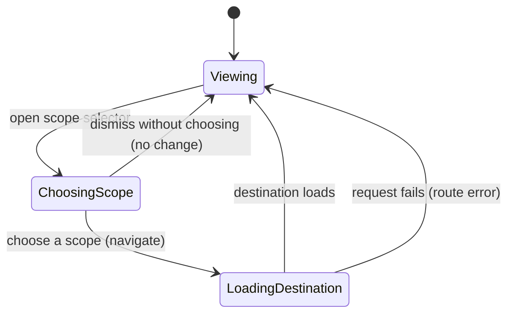

# Navigation and scope

## Summary

The application shell keeps users oriented across Backoffice's main work areas and selects the
context in which scoped resources are viewed. The header's scope selector switches among System (for
admins), organizations the user belongs to, and the user's personal area; a separate project
selector is shown alongside it. The shell also provides a collapsible sidebar, a global
workflow/activity drawer, and a quake terminal. The current route and its scope are encoded in the
URL, so links and browser navigation identify the destination.

## The simple case

A signed-in user enters an area such as Automations. The shell shows the current scope in the upper
header, the project selector, account menu, and activity control. Top-level links lead to
Automations, Sessions, Files, and Marketplace. Within Automations, a second navigation row presents
Orchestration, Events, Store, API, Integrations, MCP, and Sandboxes.

Opening the scope selector shows available choices grouped as System, Organizations, and Personal.
Selecting another organization or personal scope rebuilds the current URL for that destination. It
preserves the relevant section where the app defines a corresponding view, but does not promise to
retain a selected record or every query parameter. Project context is displayed separately; the
scope selector continues to show its parent organization while a project is active.

## The interaction, event by event

### Arrive

The route path determines the section and, on scoped routes, the scope kind and identifier. The
shell displays the resolved context. If the user has not authenticated or lacks access to the
requested scope, the route's auth and authorization behavior controls the result; a scope-shaped URL
does not itself grant access.

The scope selector is not rendered if the shell has no signed-in user or resolved scope. Admin users
receive a System choice. The list also includes organizations available in the user's membership
data and a Personal choice labeled with the user's email when available, otherwise the user ID.
Project scope is represented as its parent organization in this selector because project has a
separate adjacent control.

### Leave untouched

Closing the selector or navigating away without choosing a different scope does not change the
current route or scope. No scope mutation is submitted just by opening the menu. The selector's
exact dismissal keys and focus restoration have not been confirmed in the running app.

### Begin editing

Choosing an option initiates navigation. The destination is built from the current section and
selected scope. Automations preserves a recognized tab, defaulting to Dashboard for an unrecognized
subroute; when switching to System, API, MCP, and Sandboxes are redirected to Dashboard. Sessions
goes to its scoped sessions list, Files to its scoped root, and Marketplace preserves a recognized
marketplace tab or falls back to Marketplace. Other sections fall back to the automation dashboard,
except the known Internals routes.

When the selected organization differs from the active organization, the navigation path first
includes the organization-switch flow with a destination return path. The exact visible transition
and failure presentation require browser verification.

### While editing

There is no editable draft in this interaction: the selected scope is applied by navigation. While
the destination loads, the browser remains on a route transition. The route itself is the source of
truth for current scope, rather than a temporary selector-only value.

The neighboring project selector is a separate interaction. Do not describe selecting an
organization as selecting a project. The selector's current label and value reflect the resolved
route context; in a project route, the scope control names the parent organization.

### Submit

After the route transition, the new page shows the chosen scope if it is accessible. The browser URL
identifies the destination. There is no separate undo or confirmation step in the selector flow. If
loading or authorization fails, the user sees the route's resulting error or redirect behavior; the
precise per-route recovery is owned by the corresponding feature document.

## Modifiers

| Variant                                             | At arrival                                                                                                                                                | During editing                                                                               |
| --------------------------------------------------- | --------------------------------------------------------------------------------------------------------------------------------------------------------- | -------------------------------------------------------------------------------------------- |
| Scope kind: personal, organization, project, system | Determines available pages and which scope the shell displays.                                                                                            | Choosing a different scope navigates; project is switched separately.                        |
| User authority                                      | Admin users see the System option; other choices reflect available organization membership.                                                               | Server-side authorization remains authoritative; no effect on an operation already accepted. |
| Record/workflow state                               | Determines whether the selected route has a corresponding list/detail destination; a recognized section tab may be retained while a record detail is not. | Switching scope rebuilds the section route and may return to its list or root.               |
| Browser/network state                               | Determines whether the route can load and whether auth is current.                                                                                        | Navigation can fail or be interrupted; URL and visible page may require reload/retry.        |

Changing the selected scope is a navigation action, not a live form modifier. The precise focus and
pending-navigation treatment is not established by the inspected component.

## Cancel and interrupt

| Event                         | Before editing                                                                               | During navigation                                                                                                           |
| ----------------------------- | -------------------------------------------------------------------------------------------- | --------------------------------------------------------------------------------------------------------------------------- |
| Explicit cancel               | Dismiss the open selector; current scope remains. Escape behavior needs visual verification. | No documented cancel control for the route transition. Browser back may return to the prior route.                          |
| Navigate or switch            | Selecting another area closes/leaves the selector without changing scope.                    | A later navigation may supersede the destination; final behavior depends on router handling.                                |
| Competing completion          | No request is pending merely from opening the menu.                                          | No separate selector completion competes; route resolution is the active operation.                                         |
| Request failure               | No effect before a choice.                                                                   | Destination may show a route error, redirect, or fail to load; feature-specific recovery applies.                           |
| Page termination              | Reload/close leaves the current URL as the return location.                                  | In-flight navigation ends; already-completed server-side organization activation may persist. Exact ordering is unverified. |
| Target change                 | If membership is revoked, the next navigation may no longer be authorized.                   | A removed organization or changed access can make the destination unavailable.                                              |
| Browser/input change          | Focus change alone has no known scope effect.                                                | Browser focus loss does not imply a server rollback; keyboard behavior is unverified.                                       |
| Feature-specific state change | Admin status and available memberships determine menu choices at arrival.                    | Authority changes may invalidate the destination; no client-side guarantee is made.                                         |

After an interruption, the URL and server authority determine the current scope. Do not assume an
attempted switch was committed merely because the menu closed.

## Interactions with other systems

**Permissions.** The menu is populated from the signed-in user's available scopes, and System is
limited to admin users. Route handlers and server authorization remain the final boundary.

**Persistence/history.** Scope selection changes the route and may switch the active organization.
Browser history may return to an earlier scope URL; behavior after organization-switch redirects
should be checked.

**Parent scope.** Project routes retain their organization as the displayed scope. The project
selector handles the project context independently.

**Readonly/restricted state.** A route can be visible while its actions remain unavailable; scope
selection does not elevate authority.

**Offline.** The scope menu can display loaded options, but navigation requiring server data may not
complete while offline. No offline scope-switch guarantee is established.

**Collaboration/multiple tabs.** Another tab can change organization/session context independently.
Cross-tab synchronization of the active organization has not been established.

**Notifications.** The header's bell-shaped control is labeled Activity and opens the global
workflow drawer; it is not established as a notification inbox. No notification is known to be
emitted just for changing scope.

**Preferences and URL state.** Scope and section are encoded in route paths. Scope switching
preserves only recognized sections/tabs as described above; query-parameter preservation is not
established.

**External integrations/side effects.** Organization switching may invoke the authentication
organization's active-context flow. No external provider is involved in ordinary scope selection.

**Accessibility and analytics.** The trigger has an accessible label containing the current context.
Keyboard navigation, focus return, and analytics for scope changes have not been verified.

## Edge cases

- A project-scoped route presents its parent organization in the scope selector; use the project
  selector to change project context.
- Switching to System while on API, MCP, or Sandboxes falls back to the Automation Dashboard.
- Switching scope while viewing a detail route can land on a section list/root rather than a
  corresponding detail in the new scope.
- A user with no resolved identity or scope sees no scope selector.
- The shell registers primary-modifier+B for sidebar collapse and primary-modifier+I for the
  Activity drawer; the observed view did not exercise either shortcut.
- The activity drawer closes on an outside pointer press within the page column, but not merely
  because a popup portaled from within the drawer is clicked.
- Unknown route suffixes do not necessarily survive a scope switch; the route builder has explicit
  supported tabs and default fallbacks.
- URL construction is not proof that the destination exists or the user remains authorized.

## Open questions and verification

- Browser observation confirmed the scope and project controls and their current values, but did not
  open the scope menu or perform a switch.
- Verify menu focus behavior, dismissal, organization switch loading, selected route, and browser
  Back behavior for personal, organization, project, and admin System scopes.
- Verify which query parameters survive a scope switch; the inspected path builder operates on
  pathname and reconstructs a destination.
- The route can carry a project scope while the scope selector represents its parent organization;
  confirm the visible labels on a project page.

Verified against /Users/wilco/dev/fragno commit `7dd3c31b5`.
