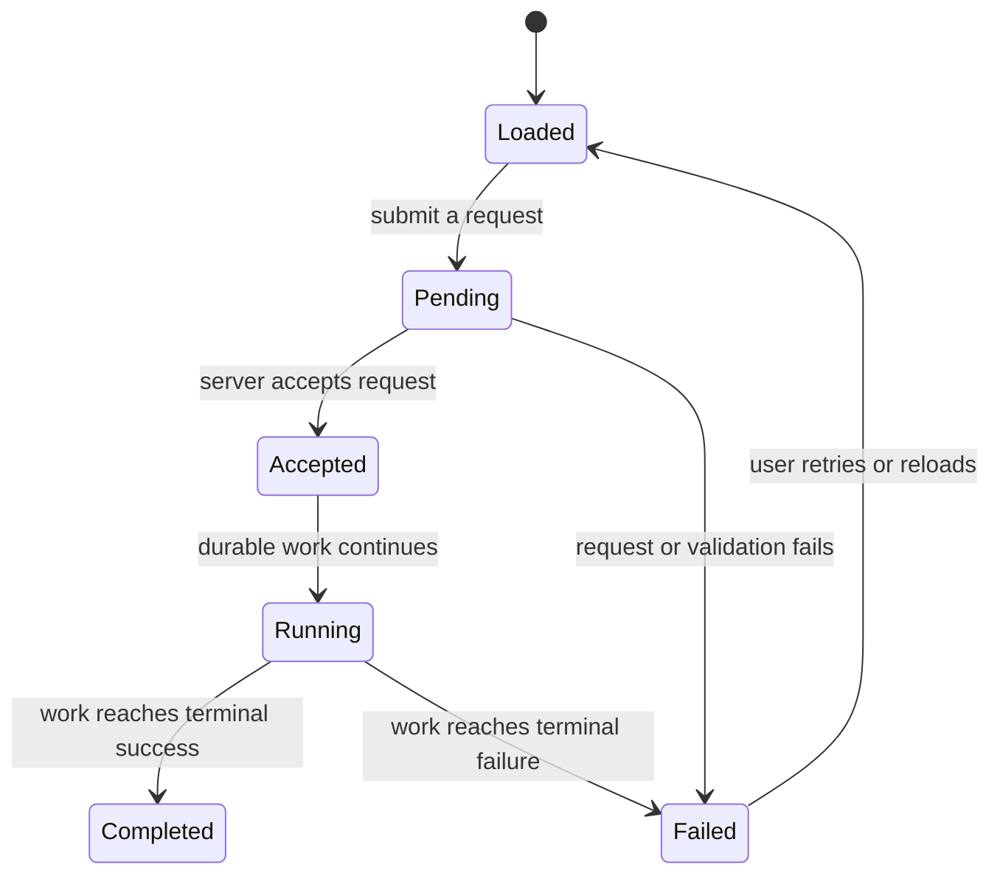

# Persistence and asynchronous work

## Summary

Backoffice mixes route-backed server data, local browser collections, persisted server records, and
work that continues asynchronously after the initiating page request. This foundation explains what
“saved” and “pending” mean across the surface. A visible page update, a queued request, and a
durable server result are different states; each feature document identifies which one the user can
observe.

## The simple case

A route loads scoped data, and the page displays it. When a user submits a mutation, the control
usually enters a pending state, the server handles the operation, and the UI either shows a success
result or refreshes its data. Some views are backed by local-first browser databases and update as
synchronized collections become ready. Other operations start a durable workflow or agent run and
return before the work itself is finished.

Files explicitly distinguish source persistence kinds such as persistent, ephemeral, or session. The
file explorer can show local synchronization loading/error states. The automation dashboard also
reports when some dashboard data cannot be synchronized. These details mean that seeing a local item
is not, by itself, proof that every remote or durable operation completed.

## The interaction, event by event

### Arrive

A route may render data from its loader and then hydrate client-side collections. For example, the
project selector and automation dashboard use local-first synchronized data; the Files route can
begin with server-provided sources and content, then replace an upload-backed tree when its browser
database becomes ready. A loading view or synchronization error is part of the user experience, not
an empty successful dataset.

Session messages and workflow instances are persisted domain records, while composer text and panel
dimensions may be local UI state. Some layout preferences are stored in browser local storage; some
automation script UI drafts are stored in a local-storage collection; automation scope history uses
session storage. These storage lifetimes are not interchangeable.

### Leave untouched

Opening a route or viewing a record does not itself write user data. Reading a synchronized view can
still initialize local persistence or fetch source data, but no user mutation is implied. A browser
storage failure can therefore affect a view without changing the remote record.

### Begin editing

An edit becomes a server-side operation when its feature submits a form/action or invokes a client
mutation. Pending controls and notices vary by feature. Do not assume a universal autosave,
optimistic update, or unsaved-changes prompt: those guarantees must be stated only where the feature
implements them.

For durable operations, “accepted” means the request was admitted or a task was created; it does not
mean the workflow, session run, marketplace ingestion, or external effect has completed. The
relevant feature's status view or polling stream owns the completion state.

### While editing

Some client-side collections synchronize in the background, so the displayed state may transition
from loading to ready or error. When a local database fails to initialize, some Backoffice routes
deliberately surface an error boundary rather than silently presenting a degraded result. The Files
explorer can show synchronization errors alongside its tree and can report when a selected
synchronized path is missing.

Session streaming and compaction have separate pending and terminal states. Compaction acceptance
starts status observation; a completed, unchanged, or failed result has a different visible outcome.
Navigation or loss of the observing page does not prove that a durable operation stopped.

### Submit

A successful synchronous mutation is reflected after its route revalidates or the page displays a
success result. A durable-work request can instead return an accepted task/instance and finish
later. If a request fails or the browser closes during an uncertain response, the user may not know
whether the server accepted it; reload the owning view to reconcile rather than blindly repeating an
irreversible action.

## Modifiers

| Variant                                             | At arrival                                                                                   | During editing                                                                                        |
| --------------------------------------------------- | -------------------------------------------------------------------------------------------- | ----------------------------------------------------------------------------------------------------- |
| Scope kind: personal, organization, project, system | Selects the resource boundary and associated persistence source.                             | Changing scope navigates and may discard local-only interaction state.                                |
| User authority                                      | Determines which server operations can be read or submitted.                                 | Authority may be rechecked at mutation time; a previously visible control does not guarantee success. |
| Record/workflow state                               | Determines whether data is loading, ready, pending, accepted, running, completed, or failed. | State transitions may reveal success, failure, or a still-running operation without a page reload.    |
| Browser/network state                               | Browser storage and network availability affect synchronization and route loading.           | A failed request or synchronization may leave the final state uncertain until reloaded/reconciled.    |

The same action can have different persistence lifetimes depending on the feature: URL, component
state, local storage, session storage, local-first database, or server record.

## Cancel and interrupt

| Event                         | Before editing                                                                               | During operation                                                                                                              |
| ----------------------------- | -------------------------------------------------------------------------------------------- | ----------------------------------------------------------------------------------------------------------------------------- |
| Explicit cancel               | Leaving a view without submitting does not create a mutation.                                | A feature-specific abort may stop observation or request cancellation; it does not automatically roll back completed effects. |
| Navigate or switch            | Route changes discard or preserve local view state according to that feature.                | Client observation may end while durable work continues.                                                                      |
| Competing completion          | No operation is pending.                                                                     | Repeated or competing submits may be disabled, rejected, deduplicated, or admitted by feature-specific rules.                 |
| Request failure               | Route loader failure is shown by route error handling.                                       | A failed response can leave accepted-vs-not-accepted ambiguous; reconcile from server state where possible.                   |
| Page termination              | Unsaved component state may be lost; browser persistence may retain some preferences/drafts. | Closing/reloading can stop streams/polling without stopping server work already admitted.                                     |
| Target change                 | A missing or inaccessible record yields a route/error state.                                 | Concurrent changes can cause rejection or refreshed data; exact conflict behavior is feature-specific.                        |
| Browser/input change          | Storage unavailable may prevent local persistence; focus alone is not a save.                | Browser offline, closed storage, or changed tab can disrupt sync; cross-tab semantics need per-feature verification.          |
| Feature-specific state change | A synchronized collection can be loading/unavailable before the user acts.                   | Workflow/session/integration terminal state changes the visible controls and result.                                          |

After an interruption, distinguish local presentation from durable server state. Reload or revisit
the owning collection to determine whether the operation completed; do not infer rollback from a
missing toast or closed tab.

## Interactions with other systems

**Permissions.** Every server write remains subject to current authority. Local cached data does not
confer permission to mutate it.

**Persistence/history.** Browser local storage, session storage, local-first databases, route data,
and durable server records have different lifetimes. Features own the exact save point and retention
behavior.

**Parent scope.** Persistence is usually keyed to user, organization, project, session, or
integration scope. Switching scope changes the data boundary.

**Readonly/restricted state.** A locally visible record can be stale or readonly; the server decides
whether a mutation is accepted.

**Offline.** The app has synchronization states, but a universal offline write queue or
conflict-resolution guarantee is not established.

**Collaboration/multiple tabs.** Some local collections may synchronize, but cross-tab or cross-user
conflict behavior must be checked per feature; do not infer real-time collaboration from local-first
rendering.

**Notifications.** Success/error notices are feature-specific. Their absence is not a durable
operation status unless a feature says so.

**Preferences and URL state.** Routes and query parameters can preserve selections. UI dimensions
and certain drafts/preferences are stored in browser storage. Feature documents identify the exact
key/state when known.

**External integrations/side effects.** An admitted workflow or agent call can perform external
effects that are not undone by closing a page or aborting later work.

**Accessibility and analytics.** Pending/complete/error states should be checked for accessible
announcements. Analytics capture is best-effort and is not a durable audit record.

## Edge cases

- A collection can be loading, unavailable, or failed; an empty list is not always the same as an
  empty successful result.
- A task can be accepted while still running; “request succeeded” and “work completed” are distinct.
- Closing a page can end polling/stream rendering without stopping a server-side workflow.
- A request can have an uncertain outcome if the connection disappears after server acceptance but
  before the response is observed.
- Browser storage may be unavailable; some preferences tolerate that and some core local-first views
  do not.
- Repeating an operation after an uncertain failure may be unsafe unless the feature explicitly
  deduplicates or supports retry.

## Open questions and verification

- Review each feature's source-specific persistence contract; this foundation intentionally does not
  claim a universal autosave, queue, retry, or rollback policy.
- Verify behavior with browser storage disabled, offline while idle and during an in-flight request,
  and reload during session streaming and marketplace ingestion.
- Automated scenario tests establish domain states but do not show the browser's pending/error
  presentation or exact timing.

Verified against /Users/wilco/dev/fragno commit `7dd3c31b5`.
