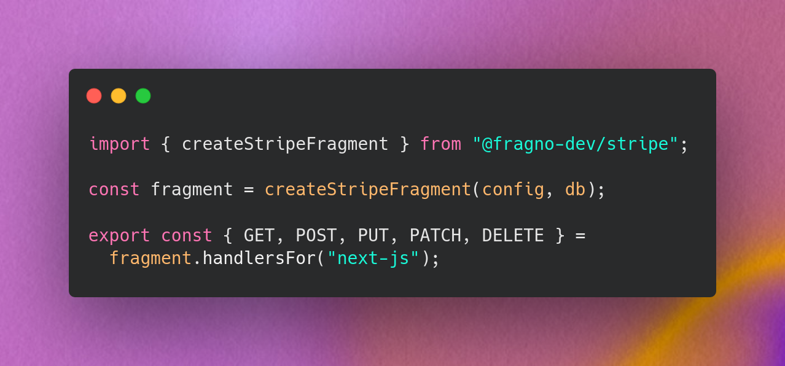

<p align="center">
  
</p>

# @fragno-dev/stripe

Stripe subscriptions library for Fragno.

It manages customers, subscriptions, and billing portal access, and handles Stripe webhooks for you.

## Who is this for?

- **App developers** who want a batteries-included Stripe subscriptions integration without wiring
  up all webhooks, routes, and client calls by hand.

You configure Stripe keys; the library provides routes and client helpers.

## Quick start

### 1. Install

```bash
npm install @fragno-dev/stripe
# or
pnpm add @fragno-dev/stripe
```

### 2. Configure on the server

```ts
import { createDurableHooksProcessor } from "@fragno-dev/db/dispatchers/node";
import { createStripeFragment } from "@fragno-dev/stripe";

export const stripe = createStripeFragment(
  {
    stripeSecretKey: process.env.STRIPE_SECRET_KEY,
    webhookSecret: process.env.STRIPE_WEBHOOK_SECRET,
    resolveEntityFromRequest: async ({ headers }) => {
      const session = await getSession(headers);
      return session
        ? { referenceId: session.user.id, customerEmail: session.user.email, customerMetadata: {} }
        : null;
    },
    onSubscriptionChanged: async ({ subscription }) => {
      // Grant or revoke access for subscription.referenceId
    },
  },
  { databaseAdapter },
);

// Webhook events are processed by durable hooks.
createDurableHooksProcessor([stripe], { pollIntervalMs: 2000 }).startPolling();
```

### 3. Client helpers

```ts
import { createStripeFragmentClient } from "@fragno-dev/stripe/react";

export const stripeClient = createStripeFragmentClient();
```

The client exposes helpers to manage subscriptions and billing flows from your frontend.

Example (React):

```tsx
import { stripeClient } from "@/lib/stripe-client";

export function UpgradeButton() {
  const { mutate } = stripeClient.upgradeSubscription();

  return (
    <button
      type="button"
      onClick={async () => {
        const { url } = await mutate({
          body: {
            priceId: "price_123",
            successUrl: `${window.location.origin}/success`,
            cancelUrl: window.location.href,
          },
        });
        window.location.href = url;
      }}
    >
      Upgrade
    </button>
  );
}
```

## Features

- **Customers and subscriptions**: the fragment links Stripe customers to your users and keeps a
  local copy of their subscriptions.
- **Billing portal redirect**: send users to Stripe's billing portal for payment methods and
  invoices.
- **Reliable webhooks**: events are verified, recorded once and processed by durable hooks that sync
  from Stripe, so retries, duplicates and out-of-order delivery are handled.
- **Typed client helpers**: simple helpers for common subscription flows.

## Documentation

For a full walkthrough and framework-specific setup (Next.js, React Router, etc.), see:

- [Stripe Quick Start](https://fragno.dev/docs/stripe/quickstart)

## Build

```bash
bun run types:check
bun run build
```
